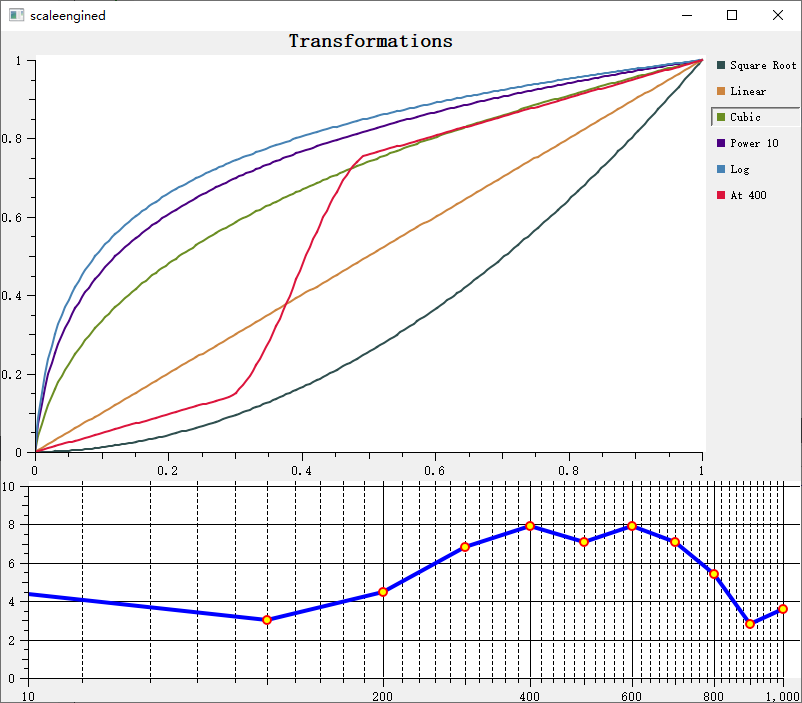

# 刻度计算引擎 - QwtScaleEngine

`QwtScaleEngine` 是坐标轴刻度的计算引擎，负责根据数据范围自动计算合理的刻度位置和标签。不同类型的刻度引擎支持不同的刻度策略。

## 主要功能特性

- 根据数据范围自动计算主刻度和次刻度
- 支持线性、对数、日期等刻度引擎
- 自动选择常用的刻度间隔（如 10、5、2）
- 支持包含或排除边界的刻度计算

## 基本概念

### 刻度引擎类型

| 引擎类 | 说明 |
|--------|------|
| `QwtLinearScaleEngine` | 线性刻度引擎（默认） |
| `QwtLogScaleEngine` | 对数刻度引擎 |
| `QwtDateScaleEngine` | 日期/时间刻度引擎 |

### 刻度划分结构

`QwtScaleDiv` 表示刻度划分结果：

```cpp
QwtScaleDiv包含:
- interval() / lowerBound() / upperBound(): 数据范围 [min, max]
- ticks(QwtScaleDiv::MajorTick): 主刻度位置列表
- ticks(QwtScaleDiv::MinorTick): 次刻度位置列表
- ticks(QwtScaleDiv::MediumTick): 中等刻度位置列表
```

## 使用方法

### 1. 线性刻度引擎（默认）

坐标轴默认使用 `QwtLinearScaleEngine`，多数情况下只需用 `QwtPlot::setAxisAutoScale()` 开启自动刻度，再通过 `setAxisMaxMajor()` 与 `setAxisMaxMinor()` 限制刻度密度即可。下面的例子让底部轴最多出现 10 个主刻度、每个主刻度区间最多 5 个次刻度：

```cpp
#include <QwtPlot>

QwtPlot* plot = new QwtPlot();

// 默认使用线性刻度引擎
plot->setAxisAutoScale(QwtAxis::XBottom);

// 设置主刻度数量上限
plot->setAxisMaxMajor(QwtAxis::XBottom, 10);  // 最多10个主刻度

// 设置次刻度数量上限
plot->setAxisMaxMinor(QwtAxis::XBottom, 5);   // 每个主刻度区间最多5个次刻度
```

### 2. 对数刻度引擎

用于大范围数据或指数关系数据：

```cpp
#include <QwtLogScaleEngine>

// 设置对数刻度引擎
plot->setAxisScaleEngine(QwtAxis::YLeft, new QwtLogScaleEngine());

// 设置对数刻度范围
plot->setAxisScale(QwtAxis::YLeft, 0.001, 1000);  // 跨越6个数量级

// 对数刻度特性：
// - 主刻度位于10^n位置（1, 10, 100, 1000...）
// - 次刻度位于中间位置（2, 3, 4, 5, 6, 7, 8, 9 全分度需 setAxisMaxMinor ≥ 9；
//   默认 maxMinor = 5 时只有 2, 4, 6, 8）
```

### 3. 日期刻度引擎

用于时间序列数据：

```cpp
#include <QwtDate>
#include <QwtDateScaleEngine>
#include <QwtDateScaleDraw>

// 设置日期刻度引擎
plot->setAxisScaleEngine(QwtAxis::XBottom, new QwtDateScaleEngine());

// 设置日期刻度绘制——格式按 QwtDate::IntervalType 选择
//（没有 QwtDateScaleDraw 自己的级别枚举）
QwtDateScaleDraw* dateDraw = new QwtDateScaleDraw();
dateDraw->setDateFormat(QwtDate::Month, QString("yyyy-MM"));  // 月份格式
dateDraw->setDateFormat(QwtDate::Day, QString("MM-dd"));      // 日期格式
plot->setAxisScaleDraw(QwtAxis::XBottom, dateDraw);

// 设置时间范围
QDateTime start = QDateTime::fromString("2024-01-01", "yyyy-MM-dd");
QDateTime end = QDateTime::fromString("2024-12-31", "yyyy-MM-dd");
plot->setAxisScale(QwtAxis::XBottom, 
    QwtDate::toDouble(start), 
    QwtDate::toDouble(end));
```

### 4. 自定义刻度划分

自动刻度不满足需求时，可以手工组装 `QwtScaleDiv`：用 `setInterval()` 设置区间，用 `setTicks()` 填入 `QwtScaleDiv::MajorTick` / `QwtScaleDiv::MinorTick` 的位置列表，再通过 `QwtPlot::setAxisScaleDiv()` 应用。下面的例子构建一个主刻度间隔 20、次刻度间隔 4 的划分：

```cpp
#include <QwtScaleDiv>

// 手动创建刻度划分
QwtScaleDiv scaleDiv;
scaleDiv.setInterval(0, 100);  // 设置范围

// 设置主刻度
QList<double> majorTicks;
majorTicks << 0 << 20 << 40 << 60 << 80 << 100;
scaleDiv.setTicks(QwtScaleDiv::MajorTick, majorTicks);

// 设置次刻度
QList<double> minorTicks;
for (int i = 0; i <= 100; i += 4) {
    if (!majorTicks.contains(i))
        minorTicks << i;
}
scaleDiv.setTicks(QwtScaleDiv::MinorTick, minorTicks);

// 应用刻度划分
plot->setAxisScaleDiv(QwtAxis::XBottom, scaleDiv);
```

### 5. 刻度引擎属性

刻度布局通过 `setAttribute()` 设置 `QwtScaleEngine::Attribute` 标志来微调：`IncludeReference` 强制参考值处出现刻度、`Symmetric` 强制范围对称、`Floating` 允许端点不落在刻度上、`Inverted` 反转刻度方向；`setMargins(lower, upper)` 则在刻度两端追加边距（以刻度单位计，`QwtLogScaleEngine` 中以“十倍程”为单位）。下面的例子取得底部轴的引擎并调整这些属性：

```cpp
// 获取刻度引擎
QwtScaleEngine* engine = plot->axisScaleEngine(QwtAxis::XBottom);

// 设置引擎属性
engine->setAttribute(QwtScaleEngine::IncludeReference, true);  // 包含参考值
engine->setAttribute(QwtScaleEngine::Symmetric, false);        // 不对称范围
engine->setAttribute(QwtScaleEngine::Floating, false);         // 不浮动端点

// 设置下、上边距（以刻度单位计）
engine->setMargins(0.5, 0.5);

// IncludeReference/Symmetric 使用的参考值
engine->setReference(0.0);
```

### 6. 计算刻度划分

刻度引擎也可以独立使用：`divideScale(x1, x2, maxMajorSteps, maxMinorSteps, stepSize = 0.0)` 接收数据范围以及主/次刻度的最大数量（还可传入固定步长），返回现成的 `QwtScaleDiv`，随后可用 `QwtPlot::setAxisScaleDiv()` 应用。下面的例子用一个局部 `QwtLinearScaleEngine` 计算刻度划分：

```cpp
#include <QwtScaleEngine>

// 手动使用引擎计算刻度
QwtLinearScaleEngine engine;
QwtScaleDiv scaleDiv = engine.divideScale(
    0, 100,   // 数据范围
    10, 5     // 最大主刻度数，最大次刻度数
    // 可选的第5个参数：固定步长
    //（默认 0.0，由引擎自行选择）
);

// 应用结果
plot->setAxisScaleDiv(QwtAxis::XBottom, scaleDiv);
```

## 刻度引擎属性说明

| 属性 | 说明 |
|------|------|
| `IncludeReference` | 强制包含参考值作为刻度 |
| `Symmetric` | 强制范围对称 |
| `Floating` | 端点不强制落在刻度上 |
| `Inverted` | 反转刻度方向 |

## 日期格式级别

`QwtDateScaleDraw::setDateFormat()` 按 `QwtDate::IntervalType` 选择格式；下表列出各级别及一种典型的自定义格式（内置默认格式因平台略有差异）：

| 级别 | 枚举值 | 典型格式 |
|------|--------|------|
| 毫秒级 | `QwtDate::Millisecond` | "hh:mm:ss:zzz" |
| 秒级 | `QwtDate::Second` | "hh:mm:ss" |
| 分钟级 | `QwtDate::Minute` | "hh:mm" |
| 小时级 | `QwtDate::Hour` | "hh:mm" |
| 日级 | `QwtDate::Day` | "dd MMM yyyy" |
| 周级 | `QwtDate::Week` | "Www yyyy" |
| 月级 | `QwtDate::Month` | "MMM yyyy" |
| 年级 | `QwtDate::Year` | "yyyy" |

## 核心方法总结

| 方法 | 说明 |
|------|------|
| `setAxisScaleEngine()` | 设置刻度引擎 |
| `setAxisAutoScale()` | 启用自动刻度 |
| `setAxisMaxMajor()` | 设置主刻度上限 |
| `setAxisMaxMinor()` | 设置次刻度上限 |
| `axisScaleEngine()` | 获取刻度引擎 |
| `axisScaleDiv()` | 获取刻度划分 |

> **提示 — 刻度优化建议**
>
> - 线性数据使用线性引擎（默认）
> - 大范围数据（跨越多个数量级）使用对数引擎
> - 时间序列数据使用日期引擎
> - 特殊需求可手动设置刻度划分

> **示例 — 相关示例**
>
> - 刻度引擎演示：`playground/scaleengine`

刻度引擎演示的例子截图如下：

