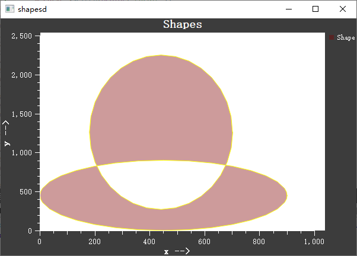

# 形状项 - QwtPlotShapeItem

`QwtPlotShapeItem` 用于在绘图上显示任意形状，支持矩形、圆形、多边形、路径等几何图形。形状使用坐标定位，会随着坐标轴变换自动调整。

## 主要功能特性

**特性**

- ✅ **任意形状支持**：支持 QPainterPath 定义的各种几何形状
- ✅ **坐标绑定**：形状位置使用绘图坐标，随缩放变换
- ✅ **样式自定义**：可设置填充、边框、颜色等样式
- ✅ **填充优化**：支持多种填充模式提升渲染性能

## 基本概念

### 形状定位

QwtPlotShapeItem 的形状使用绘图坐标定位，而非像素坐标：

```text
    Y轴
     │  ┌─────────┐
     │  │ 矩形形状 │  ← 使用(x,y)坐标定义位置
     │  └─────────┘
     └───────────────→ X轴
```

### 填充模式

| 模式 | 枚举值 | 说明 |
|------|--------|------|
| 基础填充 | `Base` | 简单填充，性能最佳 |
| 图形填充 | `Graphic` | 使用QwtGraphic存储，支持缓存 |

## 使用方法

### 1. 创建矩形形状

```cpp
#include <QwtPlot>
#include <QwtPlotShapeItem>

QwtPlot* plot = new QwtPlot();

// 创建形状项
QwtPlotShapeItem* shapeItem = new QwtPlotShapeItem("矩形区域");

// 创建矩形路径
QPainterPath path;
path.addRect(QRectF(10, 10, 50, 30));  // x, y, width, height

shapeItem->setShape(path);

// 设置样式
shapeItem->setPen(QPen(Qt::blue, 2));
shapeItem->setBrush(QBrush(QColor(100, 150, 200, 100)));

shapeItem->attach(plot);
plot->replot();
```

### 2. 创建圆形形状

```cpp
QwtPlotShapeItem* circle = new QwtPlotShapeItem("圆形");

QPainterPath path;
path.addEllipse(QPointF(50, 50), 20, 20);  // 中心点, rx, ry

circle->setShape(path);
circle->setPen(QPen(Qt::red, 1));
circle->setBrush(QBrush(QColor(255, 100, 100, 150)));

circle->attach(plot);
```

### 3. 创建多边形形状

```cpp
QwtPlotShapeItem* polygon = new QwtPlotShapeItem("多边形");

QPainterPath path;
path.moveTo(0, 0);
path.lineTo(30, 0);
path.lineTo(15, 25);
path.closeSubpath();

polygon->setShape(path);
polygon->setPen(QPen(Qt::green, 2));
polygon->setBrush(QBrush(Qt::lightGray));

polygon->attach(plot);
```

### 4. 样式配置

```cpp
// 设置填充模式
shapeItem->setFillMode(QwtPlotShapeItem::Graphic);

// 设置渲染提示
shapeItem->setRenderHint(QwtPlotShapeItem::RenderAntialiased);

// 设置边框样式
shapeItem->setPen(QPen(Qt::black, 1, Qt::DashLine));

// 设置填充样式
shapeItem->setBrush(QBrush(Qt::yellow, Qt::FDiagPattern));  // 斜线填充
```

## 核心方法总结

| 方法 | 说明 |
|------|------|
| `setShape()` | 设置形状路径 |
| `setPen()` | 设置边框画笔 |
| `setBrush()` | 设置填充画笔 |
| `setFillMode()` | 设置填充模式 |
| `setRenderHint()` | 设置渲染提示 |

> **提示 — 应用场景**
>
> - 区域标注
> - 背景区域
> - 裁剪区域标记
> - 自定义几何图形

> **示例 — 相关示例**
>
> - 形状演示：`playground/shapes`

形状演示的例子截图如下：

