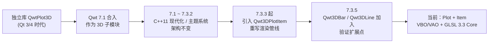
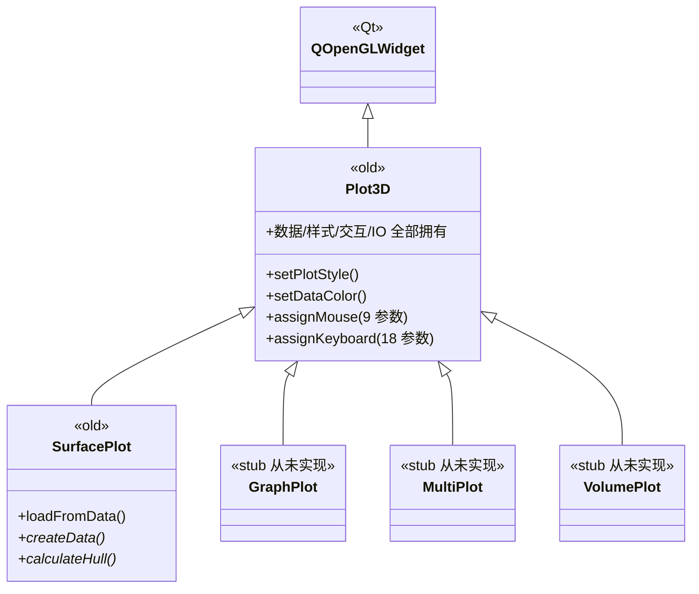
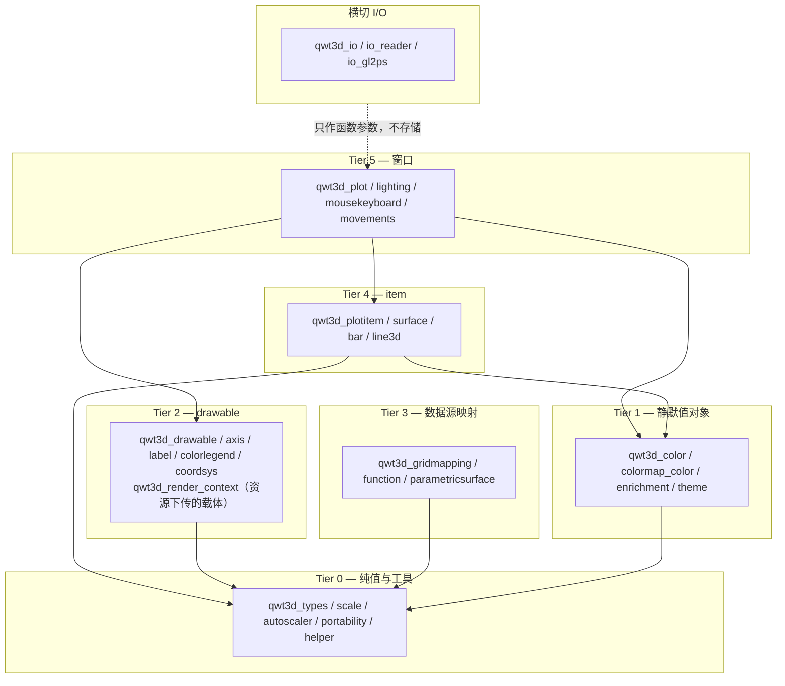
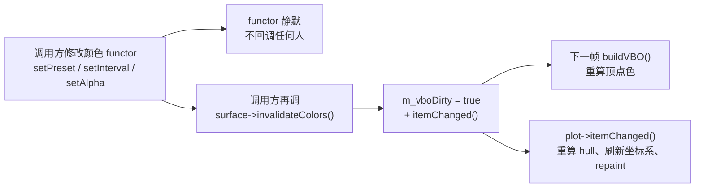
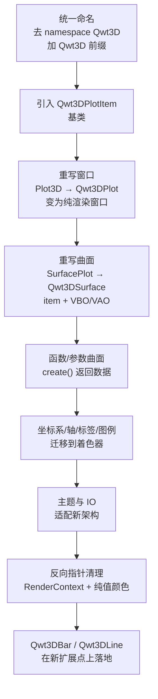
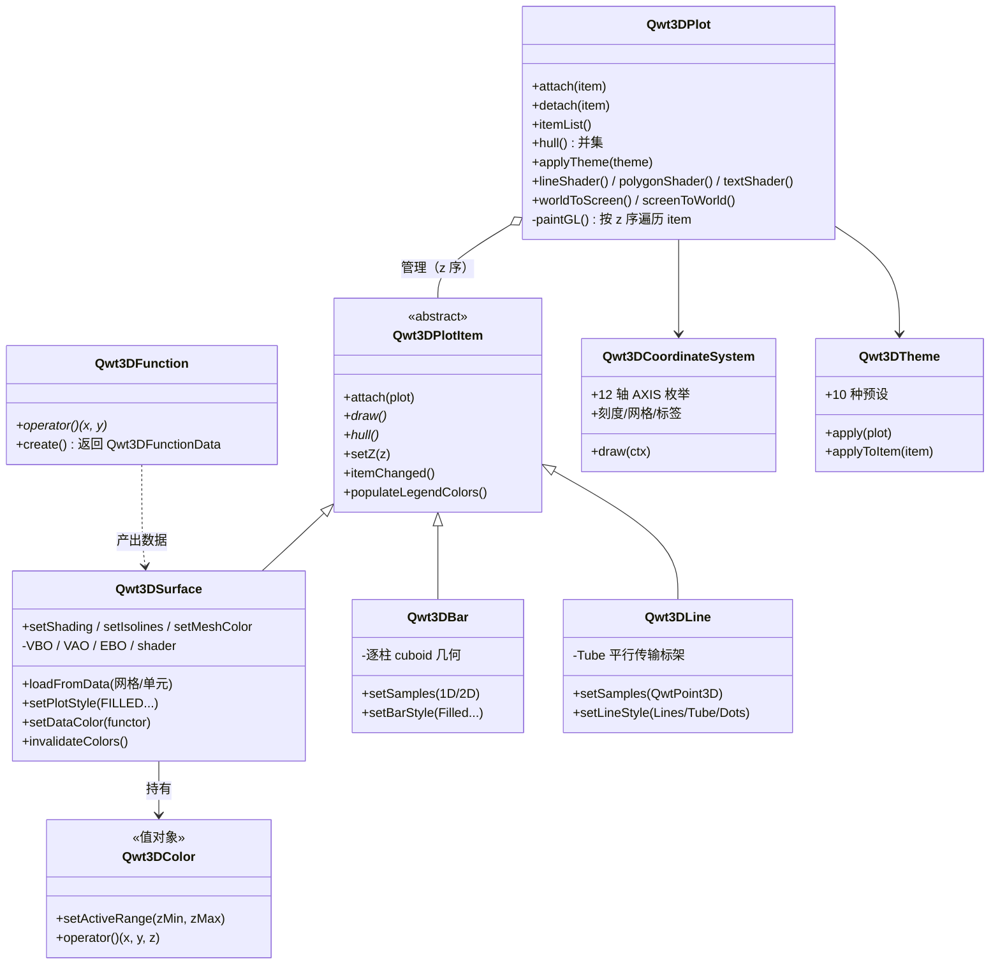
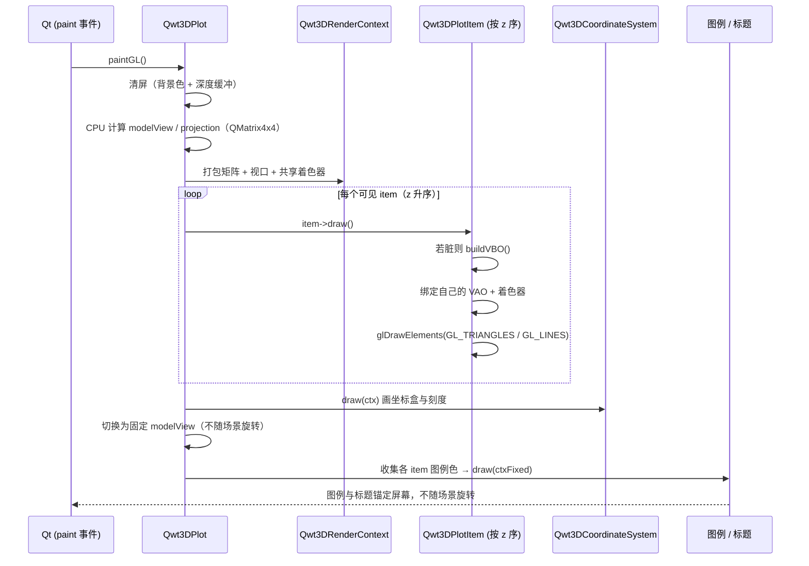
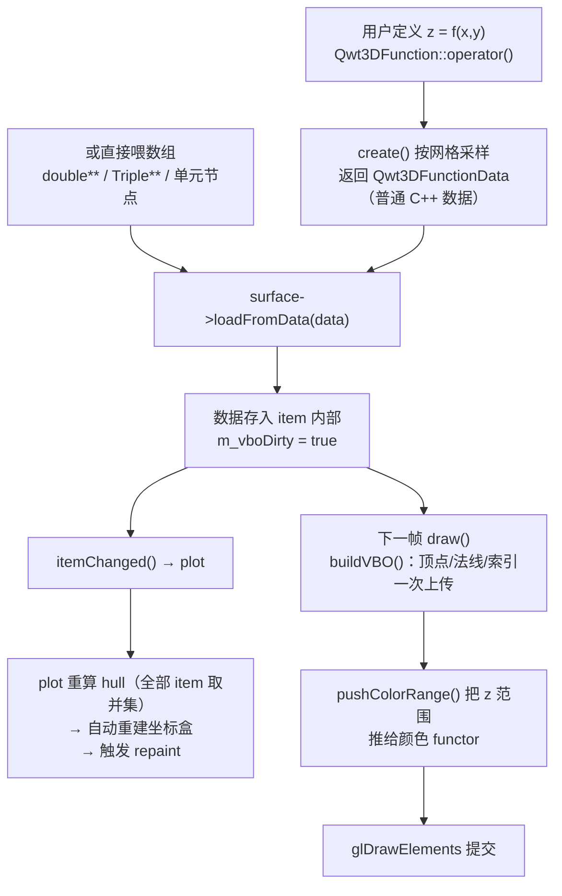
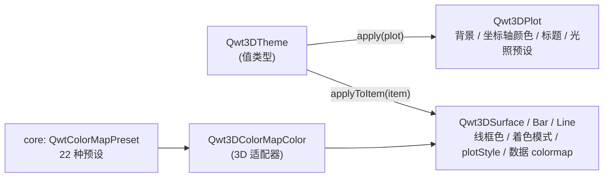

# 3D绘图架构：从QwtPlot3D到Plot + Item

本文是QWT 3D模块的**架构综述**，回答三个问题：旧的 `QwtPlot3D` 到底错在哪里、这次重构做了什么、重构后的模块为什么更合理。与 [3D绘图简介](3d-plot.md)（讲怎么用）不同，本文讲**为什么长成这样**；与 [3D模块重构说明](../../dev-guide/plot3d-refactor.md)（讲提交过程与开发约定）不同，本文面向想建立整体认知的读者，用最少的术语把设计讲透。

> **信息 — 阅读建议**
>
> 如果你只想上手画图，请先读 [3D绘图简介](3d-plot.md)。如果你改过3D模块的代码、或者想知道"新增一种3D图形要不要改窗口类"，本文会给你明确答案：**不用改**，原因在第5.4节。

## 1. 两代3D模块

QWT的3D能力有两段生命。第一段是独立的 `QwtPlot3D` 库（Qt 3/4 时代的遗产），在 Qwt 7.1 随发行合入；第二段是 QWT 7.3 系列发起的结构性重构——**保留它的数学和交互，重写它的架构和渲染**。

这次重构的核心不是"把老代码翻译成新语法"，而是换掉一类**结构性决定**：旧模块把"一个绘图窗口"和"一个绘图对象"焊死成同一个类，新模块把它们拆成两个类，并规定了两者之间唯一合法的依赖方向。下面先看旧结构为什么走不通。

## 2. 旧架构的缺陷

### 2.1 每种图形都是一个窗口

旧模块是一个**以控件为中心**的类层次：`Qwt3D::Plot3D` 直接继承 `QOpenGLWidget`，`Qwt3D::SurfacePlot` 继承 `Plot3D`。曲面不是"画在窗口里的东西"，曲面**就是**窗口。

这个模型有一个致命限制：**一个窗口只能有一种数据**。想在同一个三维场景里画"曲面 + 柱状图"，或者把两条曲线叠加到同一坐标盒中，旧架构没有任何办法——除非把数据硬塞进 `SurfacePlot` 那一份存储里。那三个 `GraphPlot` / `MultiPlot` / `VolumePlot` 名义上是"多图类型的扩展点"，实际上是空壳（只有构造函数和一个纯虚函数），重构时作为死代码删除。

### 2.2 一个"万能控件"

`Plot3D` 的公开接口有 70 多个，其中混着四类互不相干的职责：视图变换（旋转/平移/缩放）、数据与样式（`setPlotStyle` / `setDataColor` / `setMeshColor` / `setIsolines` / `setPolygonOffset` / `setShading` / `addEnrichment`）、光照与材质（`setMaterialComponent` / `setLightComponent`）、以及交互与导出（`assignMouse` / `assignKeyboard` / `savePixmap` / `saveVector`）。

更要命的是它的私有数据里直接躺着**绘图数据本身**（`Data* m_actualData`）和**GPU 缓存**（`std::vector<GLuint> m_displayLists`）。窗口与数据在存储层耦合，于是"新增一种绘图类型 = 修改中心控件"。这与2D模块形成鲜明对比：2D 早早就把 `QwtPlot`（画布）与 `QwtPlotItem`（图形对象）分开了。

重构做了什么：把混在窗口上的数据/样式成员**整体移走**。前后接口的差集是可验证的——旧 `Plot3D` 上的方法如今已从窗口类彻底消失，落在了各自的 item 上：

| 从窗口消失的成员（旧 `Plot3D`） | 现在属于 |
|------|------|
| `setPlotStyle` / `setShading` / `setIsolines` / `setMeshColor` / `setMeshLineWidth` / `setSmoothMesh` / `setPolygonOffset` | `Qwt3DSurface`（逐 item 的渲染样式） |
| `setDataColor` / `dataColor` | 各 item 的颜色 functor |
| `addEnrichment` / `degrade` / `userStyle` | `Qwt3DSurface` |
| `updateData` / `hasData` / `hull` | `Qwt3DPlotItem::itemChanged()` 与 `Qwt3DPlot::hull()`（由全部 item 取并集） |
| `setCoordinateStyle` | `Qwt3DCoordinateSystem` 直接操作 |

窗口上只留下**窗口本来该管的事**：GL 上下文、视图变换、光照、坐标系、主题、导出，以及新增的 item 管理（`attach` / `detach` / `itemList`）和共享资源访问器（`lineShader()` / `polygonShader()` / `textShader()` / `modelViewMatrix()` / `worldToScreen()`）。

### 2.3 固定管线OpenGL：已被废弃的渲染方式

旧渲染路径是一份"OpenGL 1.x 教科书"：

- **立即模式**：`glBegin/glEnd` 逐顶点提交（`qwt3d_axis.cpp`、`qwt3d_coordsys.cpp`、`qwt3d_colorlegend.cpp` 等）；
- **显示列表**：`glGenLists` / `glNewList` / `glCallList` 把几何缓存进驱动（`qwt3d_plot.cpp` 的 `m_displayLists`）；
- **矩阵栈**：`glRotatef` / `glTranslatef` / `glPushMatrix` 在 CPU/GPU 之间来回搬运变换；
- **固定管线光照**：`glLightfv` / `glMaterialfv` / `GL_COLOR_MATERIAL`（`qwt3d_lighting.cpp`）；
- **GLU 二次曲面**：`gluQuadric*` 画圆柱/圆盘（`qwt3d_enrichment_std.cpp`）、`gluProject` 做坐标投影（`qwt3d_drawable.cpp`）；
- **光栅文字**：`glRasterPos3d` + `glDrawPixels` 直接把像素贴到屏幕（`qwt3d_label.cpp`）。

这些 API 在现代 OpenGL 中**要么被删除、要么被废弃**：Core Profile（3.3+）里没有 `glBegin`、没有显示列表、没有 GLU、没有固定管线光照。后果很具体——模块无法在 Core Profile 下工作，也就无法适配 ANGLE / OpenGL ES（移动端、WebAssembly、以及 Windows 上稳定的 ANGLE 后端），而 Qt 6 的 `QOpenGLWidget` 默认正朝着 Core Profile 靠拢。同时立即模式逐帧提交顶点，是典型的 CPU→GPU 瓶颈。

重构后的方案：

| 旧                                | 新                                                | 位置                                     |
| -------------------------------- | ------------------------------------------------ | -------------------------------------- |
| `glBegin/glEnd` 逐顶点提交            | VBO + VAO + `glDrawElements` 一次绘制                | 每个 item 自带（`Qwt3DSurface::buildVBO()`） |
| 显示列表缓存                           | 常驻 VBO，`m_vboDirty` 置脏才重建，跨帧复用                   | `qwt3d_surface.cpp`                    |
| GL 矩阵栈                           | CPU 端 `QMatrix4x4` 计算，作为 uniform 传入              | `Qwt3DPlot::paintGL()`                 |
| `glLightfv` / `glMaterialfv`     | 着色器内 Blinn-Phong 光照                              | `src/plot3d/shaders/*.vert/.frag`      |
| `gluQuadric*`                    | CPU 端生成几何体（如 Tube 的扫掠截面）                         | `qwt3d_line3d.cpp`                     |
| `gluProject`                     | 纯 CPU 矩阵乘法 `Qwt3DRenderContext::worldToScreen()` | `qwt3d_render_context.cpp`             |
| `glRasterPos3d` + `glDrawPixels` | `QOpenGLTexture` 文字纹理                            | `qwt3d_label.cpp`                      |

`src/plot3d/shaders/` 下是 10 个 GLSL 3.30 Core 着色器（`surface` / `polygon` / `line` / `point` / `text` 各一对 vert+frag），构成全部图元的着色方案。

### 2.4 依赖倒置：低层反向持有高层指针

这是旧结构里最隐蔽、也最伤的一类问题。按常理，颜色计算属于底层工具，窗口属于上层，**上层认识底层是正常的，底层反手握着上层的指针就是隐患**。旧代码里这样的反向指针有三处：

1. **颜色 functor 握着窗口**：`Qwt3D::ColorMapColor(Plot3D* plot, ...)` 存 `m_plot`，构造时必须传一个窗口进来；
2. **数据映射握着曲面控件**：`Qwt3D::GridMapping::setPlotWidget(SurfacePlot*)`；
3. **绘制基类握着控件**：`Drawable` 保存顶层窗口指针用于取矩阵/视口。

反向指针的代价是真实发生过的：颜色 functor 在窗口销毁或主题切换后仍可能被访问，仓库里就留着 `fix(qwtplot3d): recreate color functor to prevent dangling pointer` 这样的修复记录——这是崩溃，而不是风格问题。它还堵死了单元测试：想单独测一个颜色 functor，必须先造一个 `QOpenGLWidget`。

重构的对策是**把依赖方向扳正，并给出一套通用机制**（第3.2、3.3节）：低层需要的上下文由上层**作为参数推下来**，而不是低层伸手去抓上层的指针。

### 2.5 命名空间不一致

旧类型全部位于 `namespace Qwt3D` 里，`Triple`、`RGBA`、`ParallelEpiped` 这些基础类型也散落在命名空间中；而 Qwt 库其余部分的约定是**全局作用域 + `Qwt` 前缀**（`QwtPlot`、`QwtPlotCurve`）。同一个库里两套命名法，`using namespace Qwt3D;` 一旦写进业务代码就是污染。

重构移除了整个命名空间，全部类型改为 `Qwt3D` 前缀（`Qwt3DPlot`、`Qwt3DSurface`、`Qwt3DColorMapColor`），与库风格统一。这是一次破坏性变更，对照表见 [3D模块重构说明](../../dev-guide/plot3d-refactor.md)。

### 2.6 与2D架构脱节

2D 模块的心智模型已经沉淀了十几年：`QwtPlot` 是画布，`QwtPlotItem` 是挂在画布上的图形对象，`attach()` / `detach()` 管生命周期，`itemChanged()` 通知重绘，样式对象（`QwtColorMap`、`QwtSymbol`）是**静默值对象**，改完由 item 主动通知。3D 模块原本完全没有这套语言，导致：

- 用户要在两套完全不同的 API 之间切换思维；
- 2D 已经趟平的坑（脏标记、所有权、通知时机）3D 要重新踩一遍；
- 无法复用 core 模块的基础设施（colormap 预设、`QwtPoint3D`、`QwtSeriesData`）。

### 2.7 缺陷小结

| 缺陷 | 直接后果 | 根因 |
|------|---------|------|
| 图形类型与窗口绑死 | 一个场景放不下多个数据集 | 以控件为中心的类层次 |
| 数据/样式/交互/IO 混在一个类 | 加一种图形要改中心类 | 职责未按变化率分离 |
| 固定管线 + 显示列表 + GLU | Core Profile 不可用，慢，无法上 ES/ANGLE | 渲染绑定 1998 年的 OpenGL |
| 低层持有高层反向指针 | 悬空指针崩溃、无法单测 | 依赖方向颠倒 |
| `namespace Qwt3D` | 与全库命名约定冲突 | 局部历史包袱 |
| 与 `QwtPlot` + `QwtPlotItem` 脱节 | 学习成本翻倍、模式不可迁移 | 两代作者各写各的 |

## 3. 重构思路：五条原则

重构不是一次性重写，而是在 `new3d` 分支上按一套固定原则渐进推进。原则比代码更重要——下面五条决定了后面所有设计决策的取舍。

### 3.1 原则一：按职责拆分，窗口只管窗口

**窗口类管的是"看"，item 管的是"画什么"。** `Qwt3DPlot` 负责 GL 上下文、视图变换、光照、坐标系、主题、item 列表——这些是**场景级**状态；`Qwt3DPlotItem` 负责数据、几何、样式、GPU 缓存——这些是**对象级**状态。

判断标准很简单：如果一个属性随数据集变化（网格分辨率、线框颜色、着色模式），它属于 item；如果一个属性对整幅图生效（背景色、灯光方向、相机角度、坐标盒范围），它属于窗口。这条界线使"一个窗口挂多个 item"成为自然结果，而不是特例。

### 3.2 原则二：依赖只能向下，上引只留一条

模块按概念分成六层，**依赖只允许指向更低的层**（或同层），任何低层 → 高层的指针都视为缺陷：

唯一被允许的"向上"指针是 `Qwt3DPlotItem::plot()`：item 渲染时确实需要窗口提供的 GL 上下文和着色器，这是一条刻意保留、写进 `src/plot3d/AGENTS.md` 的合法通道。除此之外的反向引用一律是 bug。

**为什么要这么较真？** 因为依赖方向决定了**哪些东西可以被单独测试**。Tier 0 的类型没有指向任何 3D 类的指针，可以直接做数值测试；Tier 1 的值对象没有回调，可以随便构造、拷贝、比较；Tier 2 的 drawable 只依赖传进来的上下文参数，可以在没有窗口的情况下验证绘制逻辑。

### 3.3 原则三：值对象静默，通知由上层负责

低层不能调高层，那低层状态变了怎么通知渲染？答案是**不通知**——值对象（颜色 functor、enrichment、主题）的 setter 保持静默，把"我变了"这件事交给拥有它的 item：

这与2D模块的契约**逐字对应**：改了 `QwtSymbol` 之后调 `itemChanged()`，改了 `QwtColorMap` 之后由 `QwtPlotSpectrogram` 决定怎么刷新。同一个库里的两套3D/2D API 遵循同一条纪律，用户只需要学一次。

配套的机制是**数据推入而非查询**：颜色归一化需要的 z 范围，不是 functor 自己去问 `plot()->hull()`（那需要反向指针），而是 `Qwt3DSurface::pushColorRange()` 在构建 VBO 前把并集 hull 的范围主动 `setActiveRange()` 进 functor。

> **说明 — 为什么用 `invalidateColors()` 而不是自动通知**
>
> 自动通知意味着值对象要保存宿主指针，这就绕回了旧架构的反向指针问题。显式调用把"谁负责刷新"写在代码表面，读代码的人一眼就能看出谁是脏标记的来源。

### 3.4 原则四：渲染走Core Profile

迁移不是"把 glBegin 换成 VBO"这么简单，而是**把 GPU 交互的职责也重新分了工**：

- **窗口**负责阶段性的公共状态：在 `paintGL()` 中一次性算好 modelView / projection 矩阵，打包进 `Qwt3DRenderContext` 下传，并提供共享着色器（同一个窗口的所有 item 复用 `lineShader` / `polygonShader` / `textShader`，避免每个 item 各自编译链接）；
- **item** 负责自己的私有几何：VBO / VAO / EBO 在 item 内部创建与销毁，脏了就重建，否则跨帧复用；
- **着色器**按图元类型分组（面/线/点/文字），存在 `src/plot3d/shaders/`，通过 Qt 资源系统编译进二进制。

选择 GLSL 3.30 Core 是一次**可移植性下注**：Core Profile 是桌面 OpenGL、OpenGL ES 3.0 与 ANGLE 之间的最大公约数，一条着色器路径同时覆盖 Windows / macOS / Linux 与未来的 ES 后端。

### 3.5 原则五：渐进重构，每一步都可构建

2026 年 7 月下旬的十余个提交，每个只解决一个结构问题、并保证编译通过一次：

每一步的产出物都对应仓库里一个可回溯的提交，这也是本文所有论断都可以被核对的原因——重构没有推倒重来，而是**在旧代码上连续做对的小决定**。

### 3.6 取舍：先正架构，后补特性

重构明确接受了一次"功能让位"：地板投影、法线显示、enrichment（十字丝/圆锥箭头/圆点）的**数据接口保留**，但**渲染被标记为待实现**——因为旧实现完全依赖 `glBegin/glEnd`，在 Core Profile 下根本跑不起来，而这些属于"锦上添花"的图元，不应阻塞主干架构的迁移。入口在 `src/plot3d/qwt3d_surface.cpp`：`addEnrichment()` 的文档注释与 `draw()` 末尾都留着明确的 TODO（"Enrichment rendering with VBO will be implemented in a future plan"），函数体照常接受数据、维护列表，只是暂不产出像素。

这个取舍的判断依据是：架构错误会让**每一次**后续开发都变贵（旧模块多年来的实际状态），而特性缺失是局部的、可增量补齐的。事实证明判断正确——架构理顺之后，柱状图与线图两个 item 一周内无痛加入。

## 4. 重构后的总体架构

### 4.1 一张图看全貌

下面的类图把重构后的整体架构摊开在一张画布上：`Qwt3DPlot` 管理按 z 排序的 `Qwt3DPlotItem` 列表（具体 item 为 `Qwt3DSurface`、`Qwt3DBar`、`Qwt3DLine`），`Qwt3DFunction` 负责给曲面喂数据，`Qwt3DColor` functor 决定颜色，`Qwt3DCoordinateSystem` 与 `Qwt3DTheme` 分别负责坐标盒与外观：

类职责一览：

| 类 | 角色 | 关键职责 |
|----|------|---------|
| `Qwt3DPlot` | 渲染窗口（`QOpenGLWidget`） | GL 上下文、视图/投影矩阵、光照、坐标系、主题、item 列表、导出 |
| `Qwt3DPlotItem` | 抽象 item 基类 | `attach`/`draw`/`hull`/`z`/`itemChanged`/图例颜色 |
| `Qwt3DSurface` | 曲面 item | 网格/单元数据、5 种渲染样式、颜色 functor、脏标记驱动的 VBO |
| `Qwt3DBar` / `Qwt3DLine` | 柱状图 / 线图 item | 独立几何与样式，自包含 |
| `Qwt3DFunction` / `Qwt3DParametricSurface` | 数据源映射 | 把 `z=f(x,y)` 或 `r(u,v)` 采样成数据结构体 |
| `Qwt3DCoordinateSystem` | 坐标盒 | 12 轴（`X1`–`Z4`）、刻度、网格、标签 |
| `Qwt3DColor`（含 `Qwt3DColorMapColor`） | 颜色 functor | 静默值对象，桥接 core 的 colormap 预设 |
| `Qwt3DTheme` | 主题 | 控件级与 item 级属性的统一描述 |

### 4.2 一帧是怎么画出来的

`paintGL()` 是理解新架构最好的切片——它清楚地展示了"窗口准备什么、item 准备什么"：

两个设计细节值得单独说：

- **`Qwt3DRenderContext` 是值对象，不是指针**。它按调用点构造（矩阵、视口、共享着色器指针），以 const 引用沿 draw 链下传。这直接消灭了旧 `Drawable` 里那根 `Qwt3DPlot*` 反向指针——drawable 需要的一切都在参数里，自己不认识窗口。
- **图例/标题使用固定矩阵**。这两样东西锚在屏幕上，如果跟着场景一起转就错了；窗口在最后一个绘制阶段把 modelView 换成一个不随用户交互变化的基准矩阵，保证 UI 元素稳定。

### 4.3 数据怎么流到GPU

下面的流程图跟踪一份数据去往 GPU 的完整旅程：从用户定义的 `Qwt3DFunction`（或直接喂入的数组）出发，经过 `loadFromData()`、`itemChanged()` 通知与 hull 重算，直到下一帧 `draw()` 里延迟执行的 `buildVBO()` 上传和最终的 `glDrawElements` 提交：

这条链上没有任何环节需要低层回调高层：数据源**返回**数据，item **请求**刷新，窗口**汇总**各 item 的 hull 决定坐标盒——职责在一条单向链上流动。特别注意 hull 的处理：`Qwt3DPlot::hull()` 是**全部 item 包围盒的并集**，坐标系会据此自动定位；多 item 叠加时，坐标盒自动贴合数据范围，不需要用户手工同步。

> **警告 — 先 attach，再灌数据**
>
> hull 的重算只发生在 `itemChanged()` 里，而 `Qwt3DPlot::attach()` 本身不重算 hull。如果你先 `loadFromData()` 再 `attach()`，之后又不再改动任何属性——那么 item 的通知在挂载之前就发完了（`itemChanged()` 只在 `plot()` 非空时才通知窗口），窗口的 hull 停留在退化的原点，坐标盒建立不起来，整幅图**空白且没有任何警告**。正确顺序是：`item->attach(plot)` 在前，`loadFromData()` 及各类 setter 在后。

### 4.4 颜色与主题：接入core生态

3D 模块不重复造颜色系统的轮子，而是**适配** core 模块：

- `Qwt3DColorMapColor` 桥接 `QwtColorMap` 与 core 的 22 种科学 colormap 预设（`viridis`、`plasma`、`jet`、`coolwarm` …），2D 光谱图和 3D 曲面因此可以使用**同一份预设表**；
- `Qwt3DTheme` 的 10 种预设把背景、坐标轴、标题、网格、光照预设（`NoLighting`/`FlatLight`/`Studio`/`Outdoor`/`Soft`）打包成一个值类型，`plot->applyTheme(...)` 一次到位；
- 主题落地时分成两半：控件级属性（背景、坐标色、光照）施加到 `Qwt3DPlot`，item 级属性（线框色、着色模式、渲染样式、数据 colormap）通过 `applyToItem()` 施加到每个已挂载的 item——**这正是 Plot/Item 拆分带来的副产品**：主题不再需要知道"我长什么样"，它只需要描述属性，由两个接收方各自落实。

### 4.5 与2D、与core的关系

模块依赖是一条单向边：`plot3d` → `core`，**不依赖** `plot`（2D）。也就是说 3D 独立成库，但通过 core 与 2D 共享基础设施——`Qwt3DLine::setSamples()` 直接收 `QVector<QwtPoint3D>` / `QwtSeriesData<QwtPoint3D>`（core 的类型，也是 2D `QwtPlotCurve` 的数据语言），两个模块的数据契约是同一个。

在展示层，二者可以同框：`examples/3D/figureSurface3D` 在一个 `QwtFigure` 网格里同时放置 3D 曲面窗口和 2D 横截面/时间序列曲线，3D 场景一动，2D 曲线跟着重采样——这在旧架构下需要跨越两套完全不同的事件模型，现在只需要各自 `attach()` 到各自的画布。

## 5. 收益与先进性

### 5.1 逐条对照

| 旧缺陷 | 重构后 | 谁因此受益 |
|--------|--------|-----------|
| 一个窗口一种数据 | 一个窗口任意个 item，z 序控制叠加 | 需要多图层对比的用户 |
| 加图形要改中心类 | 新 item 自包含接入，`Qwt3DPlot` 零改动 | 模块维护者 |
| Core Profile 不可用 | VBO/VAO + GLSL 3.30，可移植到 ES/ANGLE | 移动端 / ANGLE / Wayland 用户 |
| 逐帧立即模式提交 | 一次上传、脏标记重建、跨帧复用 | 大网格与动画场景 |
| 反向指针 → 悬空指针 | 依赖分层 + `RenderContext` 下传 | 全体（少一类崩溃） |
| 值对象不可单测 | Tier 0/1 可脱离窗口测试 | 有回归测试诉求的团队 |
| 命名空间割裂 | `Qwt3D` 前缀统一 | 新用户 |
| 两套心智模型 | 与 `QwtPlot` + `QwtPlotItem` 对称 | 从 2D 迁移过来的用户 |

### 5.2 扩展点是被验证过的，不是画在图上的

"Plot + Item 是好架构"这类判断不能靠宣称，要看**第二个、第三个实现进来时改动了多少**。仓库给出了答案：`Qwt3DBar`（柱状图，逐柱立方体、6 面扁平法向，1D 序列或 2D 网格）与 `Qwt3DLine`（线图，`Lines`/`Tube`/`Dots` 三种样式）都是**新增文件 + 新增 item 子类**，`Qwt3DPlot` 一行未改。

这两个 item 还顺便示范了架构的几个约束确实被遵守：

- 自带 VBO/VAO 与惰性重建（`qwt3d_bar.cpp`、`qwt3d_line3d.cpp`），不碰窗口的 GPU 资源；
- 实现 `hull()` 参与坐标盒并集计算；
- 实现 `populateLegendColors()` 接入统一图例；
- 遵循 `invalidateColors()` / `itemChanged()` 的通知契约。

需要如实说明的是，"零改动"限定在窗口类：`Qwt3DTheme::applyToItem()`（`qwt3d_theme.cpp`）目前按具体 item 类型 `dynamic_cast` 分发 item 级属性，新增 item 想接收主题的线框色与数据 colormap，需要在那里补一个分支。这是主题按类型分发带来的少量扩展成本，与"修改窗口类"完全不是一回事。

其中 `Qwt3DLine` 的 Tube 样式用了**平行传输标架**（parallel-transport framing）沿折线扫掠圆柱截面——这类细节以前必须侵入窗口类才能实现，现在是 item 的私事。柱状图与线图的完整用法见 [3D柱状图](3d-bar-chart.md) 与 [3D线图](3d-line-plot.md)。

### 5.3 渲染层面的先进性

- **Core Profile 兼容**：全部图元走着色器，没有一条被废弃的 GL 调用；
- **共享着色器**：窗口级复用，item 创建/销毁不触发编译链接；
- **脏标记 + 常驻 VBO**：数据不动就零拷贝，动画场景只在数据变化的帧重建顶点缓冲；
- **CPU 端矩阵**：视图变换是普通 `QMatrix4x4` 运算，可打印、可序列化、可单测（`worldToScreen()` 甚至不需要 GL 上下文就能算）；
- **矢量导出保留**：`gl2ps` 无条件编译，`saveVector()` 支持 EPS / PS / PDF / SVG / PGF，作为 Core Profile 管线之外的回退通道；
- **序列化地基**：`qwt3d_serialize.h` 为 `Triple`、`RGBA`、`ParallelEpiped`、`Qwt3DFunctionData` 等值类型提供了 `QDataStream` 运算符，配合 `Qwt3DIO` 的 `save()`/`load()` 可扩展到整图持久化。

**一帧到底要多久（实测基线）**：在 MSVC2019 + Qt 6.7.3、Release 构建、1000×700 视口下用 `glFinish` 包住 `paintGL()` 计时，得到一组基线数据（同一台机器上的绝对值，用来感受量级，不是跨平台对比）：

| 场景 | 单帧耗时 |
|------|---------|
| 30 × 512 网格曲面 | 3.3 ms |
| 300 × 512 网格曲面 | 6.0 ms |
| 1000 × 512（约 51 万顶点） | 7.6 ms |
| Tube 样式 300 × 1024 | 12.3 ms |

对"百来条迹线 × 数百采样点、30 fps"这类典型工作负载，"一次上传、逐帧零拷贝"的 VBO 模型留有充足余量；单条迹线更新触发的局部顶点缓冲重建实测接近 0 ms，动画场景的开销主要落在数据变化的那一帧。

### 5.4 生态统一的复利

2D 与 3D 现在共享同一套**颜色语言**（core colormap 预设）、同一套**数据语言**（`QwtPoint3D` / `QwtSeriesData`）、同一套**通知语言**（`itemChanged()` 与静默值对象），以及同一套**构建语言**（CMake target：`qwt::core` / `qwt::plot` / `qwt::plot3d`）。这些对齐是"看不见的收益"，但它意味着：2D 修过的 bug 不会在 3D 复现，2D 新增的 colormap 自动可用，用户学到一半的 API 猜测在 3D 里照样猜得中。

## 6. 已知局限与后续工作

架构文章如果只列优点就没有价值。当前状态的诚实清单：

| 事项 | 状态 | 位置 |
|------|------|------|
| enrichment 渲染（十字丝/圆锥/箭头） | 数据接口在，渲染待实现 | `qwt3d_surface.cpp` 的 `addEnrichment()` 与 `draw()` 末尾 TODO |
| 地板投影（`setFloorStyle`） | 同上，渲染待实现 | `qwt3d_surface.cpp` floor 相关 TODO |
| 法线显示（`showNormals`） | 同上 | 同上 |
| gl2ps 矢量导出 | 依赖 Compatibility Profile 状态，Core Profile 下变换可能不正确（源码注释已声明为已知限制） | `qwt3d_io_gl2ps.h` 类注释 |
| item 包围盒 | 规则长方体（`ParallelEpiped`），不含旋转后的 AABB | `Qwt3DPlotItem::hull()` 契约 |
| 3D 渲染路径自动化测试 | 尚无（`tests/` 目前仅覆盖 2D picker） | `tests/` |

> **已知问题 — 如果你依赖上述特性**
>
> 升级到新架构前请核对上面这张表。旧模块能画出地板投影和 enrichment（见库内存档截图），新模块的数据接口已就位但像素还没跟上——这是**有意的让步**（见 3.6 节），不是遗漏。

## 7. 代码与示例索引

### 7.1 从哪里读起

| 想弄明白 | 读这里 |
|---------|--------|
| 窗口做哪些事 | `src/plot3d/qwt3d_plot.cpp` 的 `paintGL()`（约一百行，覆盖全帧流程） |
| item 的契约 | `src/plot3d/qwt3d_plotitem.h`（类注释含自定义 item 示例） |
| 一个真实 item 的完整实现 | `src/plot3d/qwt3d_surface.cpp` 的 `buildVBO()` 与 `draw()` |
| 上下文如何下传 | `src/plot3d/qwt3d_render_context.h` |
| 依赖分层规则 | `src/plot3d/AGENTS.md`（Tier 0–5 与 DO/DON'T 清单） |
| 重构前后对照 | `docs/zh/dev-guide/plot3d-refactor.md` |
| 着色器 | `src/plot3d/shaders/`（surface/polygon/line/point/text 各一对） |

### 7.2 示例

| 示例 | 看什么 |
|------|--------|
| `examples/3D/qwtplot3d` | 综合演示：主题切换、颜色条、5 种数据源切换、动画曲面、保存位图 |
| `examples/3D/bar3D` | `Qwt3DBar`：1D 序列 / 2D 网格柱状图与样式面板 |
| `examples/3D/line3D` | `Qwt3DLine`：`Lines`/`Tube`/`Dots`、点形状与逐顶点着色 |
| `examples/3D/waterfall3D` | `Qwt3DWaterfall`：2D 实时频谱 + 3D 滑动窗口瀑布同框，全部样式/上色模式，`--screenshot`/`--selftest`/`--fps` 自动化 |
| `examples/3D/figureSurface3D` | 3D 曲面窗口与 2D 横截面/时间序列在 `QwtFigure` 中同框联动 |

综合演示与 3D 曲面渲染效果（截图存档于 `docs/assets/screenshots-3D/`，要核对当前版本的实际效果请运行上面的示例）：

坐标系统的轴、刻度与标签（12 轴体系仍由 `Qwt3DCoordinateSystem` 渲染）：

3D 曲面窗口与 2D 曲线在同一 Figure 布局中混排：

### 7.3 延伸阅读

- [3D绘图简介](3d-plot.md) —— API 与用法
- [3D柱状图](3d-bar-chart.md) / [3D线图](3d-line-plot.md) —— 两个新 item 类型
- [3D模块重构说明](../../dev-guide/plot3d-refactor.md) —— 提交流程、迁移对照表、开发约定
- `src/plot3d/AGENTS.md` —— 模块级分层规则（含 DO/DON'T 反例）
- 仓库根目录 `AGENTS.md` —— 全库构建与编码约定
