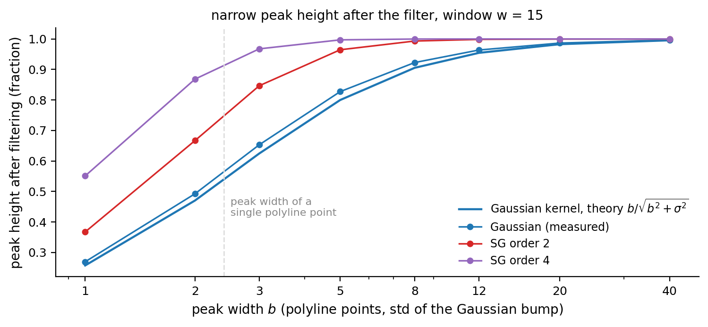
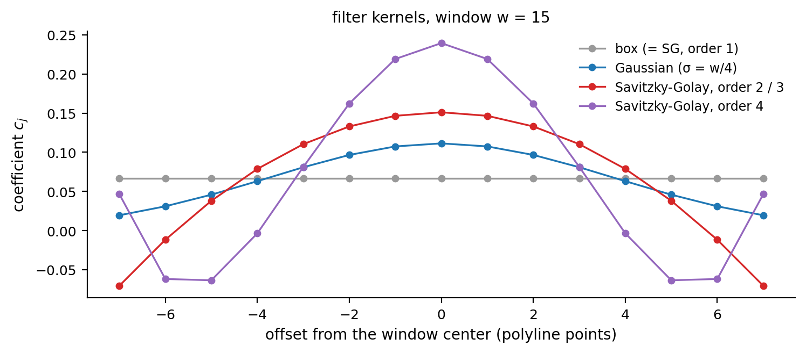
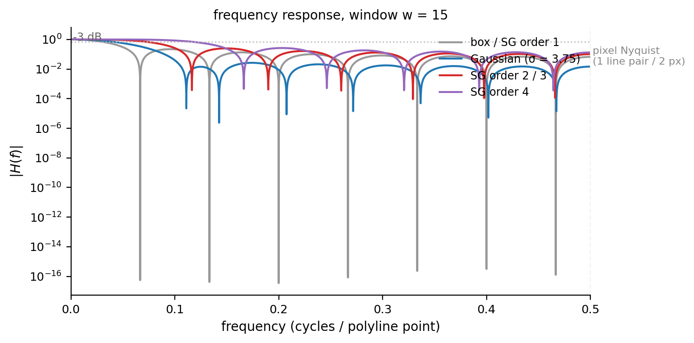
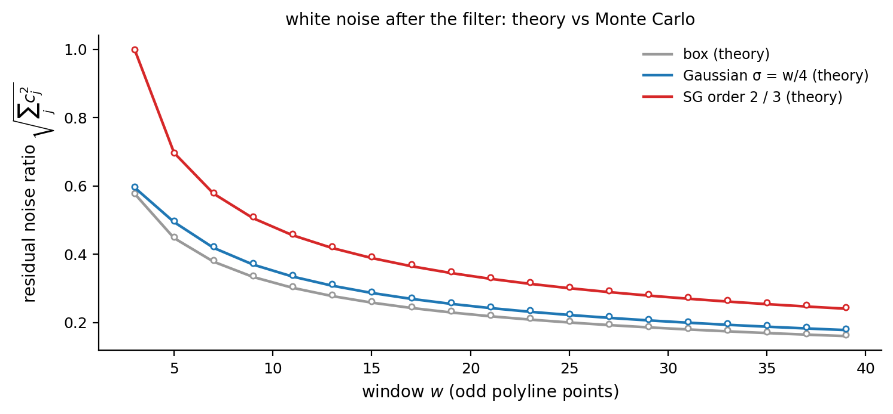
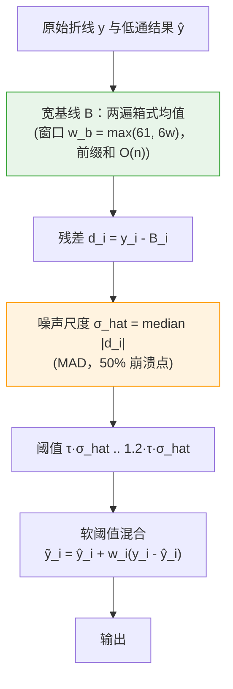
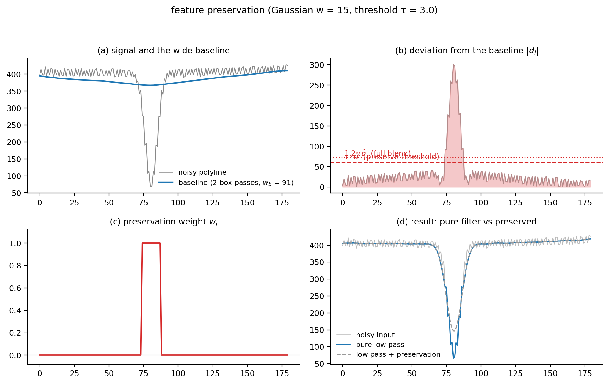
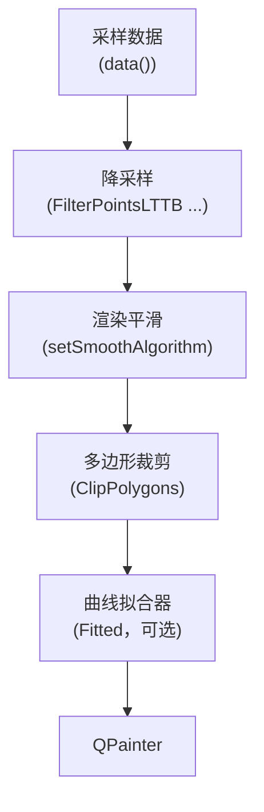
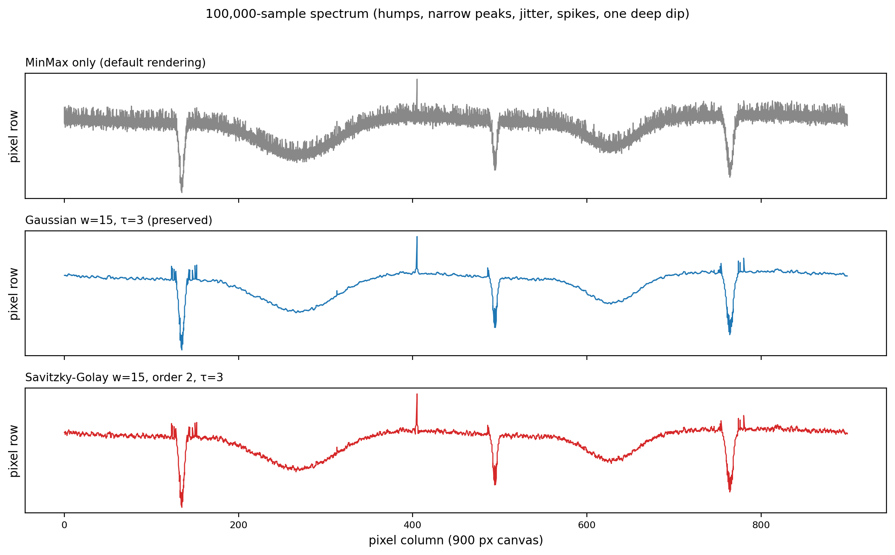

# 曲线渲染平滑：高斯卷积、Savitzky-Golay 回归与特征保护

> **摘要** —— 降采样解决的是"点太多画不动"，平滑解决的是"画出来像噪声"。上一篇文章的结论在这里变成前提：MinMax 桶降采样**刻意保留每个桶的极值**，因此随机抖动的极值也全部幸存——实测 100,000 点频谱在 900×500 画布上经降采样后，噪声带平均厚度仍有 65 像素行。QWT7.4 的渲染平滑在绘制管线的折线上直接施加低通滤波：**高斯加权卷积**与 **Savitzky-Golay 局部多项式回归**，两者只修改 $y$ 坐标、不触碰采样数据。本文从偏差-方差分解出发，完整推导两种核的数学结构（含 Savitzky-Golay 的矩条件、$p=2$ 与 $p=3$ 等价的奇偶论证、以及"噪声增益等于核中心系数"的恒等式），随后剖析第三块拼图——**特征保护**：用宽基线 + MAD 稳健噪声估计 + 软阈值混合，把被滤波器削平的峰谷恢复到原始位置与高度。全部性质附数值实验验证与完整代码实践。

!!! abstract "核心结论"
    - 高斯核（$\sigma = w/4$）噪声抑制最强（$w=15$ 时残余噪声为输入的 28.6%），但对窄峰的衰减有闭式解：$b/\sqrt{b^2+\sigma^2}$——一个 $\sigma=3.75$ 的核会把宽度 $b=3$ 点的峰削去 35% 的高度
    - Savitzky-Golay 核是"中心点处局部多项式最小二乘"的等价卷积形式：任意 $p$ 阶多项式零失真通过（多项式保持定理），因此保峰能力远强于高斯，代价是残余噪声高约 36%（同窗口下 $\sqrt{g}=0.389$ vs $0.287$）
    - 特征保护把"线性的、无差别的衰减"变成"非线性的、有选择的保留"：默认 $\tau = 3$ 时，窄峰峰顶与深谷谷底的像素行与未平滑渲染**逐行一致**，而噪声带从 65.4 px 收敛到 6.1 px（高斯 + LTTB，900×500 画布实测）

---

## 1. 引言：降采样为什么去不掉噪声

从上篇文章的命题 1（全局极值保留）可以立即推出一个反直觉的结论：

**推论（噪声幸存）** 若输入包含随机抖动，则抖动在每个桶内几乎必然产生极值；MinMax 桶保留每桶极值 ⇒ **抖动的极值被完整保留**。降采样后的折线不是"更干净"，而是"更少的点、同样的毛刺"。

实测（与前篇相同的 100,000 点频谱、900×500 画布、MinMax 桶降采样）：折线的列包络平均厚度 **65.4 像素行**——以 1 像素宽的画笔绘制时，这是一条 60 多像素宽的"噪声带"。

为什么不在数据层平滑？两个理由：

1. **数据是资产**。采样数据要用于分析、导出、与其他工具互操作；渲染平滑去掉了毛刺，但 `data()` 里的原始值分毫未动。
2. **渲染层平滑是可逆的**。它作用于每次绘制的折线，窗口以"渲染点"计而不是以"采样"计——缩放时窗口的视觉效果恒定（第 6 节论证）。在数据层做固定窗口平滑，放大后平滑强度会发生变化。

`Fitted` 属性也救不了场：它是**插值**（样条穿过每一个点），插值精确复现噪声而不是滤除它。真正需要的是一个**低通滤波器**。

## 2. 问题形式化

### 2.1 信号模型

设降采样后的折线为 $(x_i, \hat{y}_i)$（$y$ 是像素行），假设

$$
\hat{y}_i = f(x_i) + \varepsilon_i, \qquad \varepsilon_i \sim \mathcal{N}(0, \sigma^2), \quad \text{i.i.d.}
$$

其中 $f$ 是"真实形状"（光滑、低频），$\varepsilon$ 是渲染噪声（抖动、毛刺）。目标是估计 $\hat{f} = (\hat{y}_1, \ldots, \hat{y}_n)$，使均方误差最小。对任意估计器有偏差-方差分解

$$
\mathbb{E}\left[ (\hat{f} - f)^2 \right] = \underbrace{\left( \mathbb{E}[\hat{f}] - f \right)^2}_{\text{偏差}^2} + \underbrace{\operatorname{Var}[\hat{f}]}_{\text{方差}}
$$

- **偏差**来自"过度平滑"：峰被削矮、形状变圆——这是不可逆的数据失真；
- **方差**来自"欠平滑"：噪声残余——这是视觉上的毛刺。

两种核分别对应两种权衡：高斯把方差压到最低（偏差更大），Savitzky-Golay 把偏差压到最低（方差更大）。特征保护（第 5 节）则试图**同时消除两者**：对噪声区取低方差估计，对特征区取零偏差估计。

### 2.2 线性平移不变滤波器

两类核都属于**线性平移不变**（LSI）滤波器，输出是输入的卷积：

$$
\hat{f}_i = \sum_{j=-m}^{m} c_j\, \hat{y}_{i+j}, \qquad m = \frac{w-1}{2}
$$

其中 $w$ 为奇数窗口。两个基本约束：

1. **直流增益为 1**（常数信号不变）：$\sum_j c_j = 1$；
2. **零相位**（不引入水平偏移）：核对称 $c_{-j} = c_j$。

零相位意味着频响为实值偶函数：$H(\omega) = c_0 + 2\sum_{j=1}^m c_j \cos(j\omega)$，对输入没有相位失真——峰的位置（保持在其 $x$ 处）只可能被削矮，不可能被平移。

### 2.3 频域视角

低通滤波的频响刻画：低于截止频率的成分近似不变（$|H| \approx 1$），高于截止频率的成分被衰减。两个常用标量：

- **噪声增益** $g = \sum_j c_j^2$：白噪声经滤波后方差变为 $\sigma^2 g$（零相位对称核、i.i.d. 假设下由卷积的直接计算得到）。剩余噪声标准差 $\sigma\sqrt{g}$ 是"噪声抑制"的定量指标；
- **-3 dB 截止频率**：$|H(f_c)| = 1/\sqrt{2}$。

两个指标描述同一枚硬币的两面：截止越早（$f_c$ 小），噪声增益越低。

## 3. 高斯核平滑（GaussianSmoothing）

### 3.1 定义

连续高斯核与 QWT7 的离散化：

$$
G_{\sigma}(t) = \frac{1}{\sqrt{2\pi}\,\sigma}\, e^{-t^2 / 2\sigma^2}, \qquad
c_j = \frac{e^{-j^2 / 2\sigma^2}}{\sum_{k=-m}^{m} e^{-k^2 / 2\sigma^2}}, \qquad
\sigma = \max\left(1,\ \frac{w}{4}\right)
$$

分母归一化保证直流增益 1。窗口宽度 $w = 4\sigma$ 意味着窗口覆盖 $\pm 2\sigma$——高斯主体（占全部质量的 95.4%）都在窗内，截断误差可忽略。

### 3.2 频域性质

连续高斯核的傅里叶变换仍是高斯（高斯是傅里叶变换的不动点族）：

$$
\mathcal{F}\left[ G_\sigma \right](f) = e^{-2\pi^2 \sigma^2 f^2}
$$

因此 -3 dB 截止频率有闭式解：

$$
f_c = \frac{\sqrt{\ln 2}}{2\pi \sigma} \approx \frac{0.1325}{\sigma}
$$

实测（离散核，第 7 节）：$w=15$（$\sigma=3.75$）时 $f_c = 0.0394$ 周期/点，与闭式解 0.0353 吻合（离散化的截断让截止略微后移）。**为什么研究它**：把 1 个"折线点"想成 1 个像素列，$f_c = 0.0394$ 意味着周期短于约 25 个像素列的结构都会被打薄——这就是"高斯平滑会让窄峰变圆"的定量来源。

### 3.3 峰值衰减定理：闭式解

**定理（峰值衰减）** 设信号峰是宽度为 $b$（标准差）的高斯凸包 $f(t) = h\, e^{-t^2/2b^2}$，经过标准差 $\sigma$ 的高斯核卷积后仍是高斯，宽度相加、面积守恒：

$$
f * G_\sigma (t) = h \cdot \frac{b}{\sqrt{b^2 + \sigma^2}} \cdot \exp\!\left( -\frac{t^2}{2(b^2+\sigma^2)} \right)
$$

*证明*：两个高斯卷积=积的核（$e^{-u^2/2b^2} e^{-(t-u)^2/2\sigma^2}$ 配方法）即得——方差相加 $b^2 + \sigma^2$，归一化常数按 $\frac{1}{\sqrt{2\pi}\sqrt{b^2+\sigma^2}}$ 收缩。面积（$\int f = \sqrt{2\pi} b h$）在卷积下不变，于是高度按宽度比收缩。$\square$

**推论（峰值保持率）**

$$
R(b) = \frac{b}{\sqrt{b^2 + \sigma^2}}
$$



数值（$w = 15$，$\sigma = 3.75$）：

| 峰宽 $b$（点） | 高斯实测 | 理论 | SG $p=2$ | SG $p=4$ |
|---|---|---|---|---|
| 1 | 0.270 | 0.258 | 0.368 | 0.551 |
| 2 | 0.493 | 0.471 | 0.667 | 0.868 |
| 3 | 0.653 | 0.625 | 0.847 | 0.968 |
| 5 | 0.828 | 0.800 | 0.965 | 0.997 |
| 8 | 0.923 | 0.906 | 0.993 | 1.000 |
| 12 | 0.964 | 0.955 | 0.999 | 1.000 |

宽带为 1–3 点的窄峰（即第 4 节要保护的"特征"）被高斯核削去 35%–73% 的高度——**不加以保护时，窄峰不是变圆，而是明显变矮**。这就是为什么平滑必须搭配特征保护（第 5 节）。

### 3.4 尺度空间解释

高斯卷积还等价于热扩散方程的一个时间步。设 $u(t, s)$ 满足

$$
\frac{\partial u}{\partial s} = \frac{1}{2}\frac{\partial^2 u}{\partial t^2}, \qquad u(t, 0) = f(t)
$$

则 $u(t, s) = f * G_{\sqrt{s}}(t)$——对 $f$ 做标准差 $\sqrt{s}$ 的高斯卷积，正好是"把信号演化到尺度 $s$"。这个视角给出了高斯平滑的深层身份：它是**尺度空间滤波**，与图像处理中的金字塔、边缘检测的尺度空间理论一脉相承。而 QWT7 的 $\sigma = w/4$ 只是固定选取了一个演化时间。

### 3.5 边界处理：镜像延拓

折线两端没有邻居，需要延拓。QWT7 采用**镜像反射**（`qwtReflectIndex`）：索引出界时按边界点反射

$$
i < \text{lo} \Rightarrow i' = 2\cdot\text{lo} - i, \qquad
i \ge \text{hi} \Rightarrow i' = 2(\text{hi}-1) - i
$$

以边界采样点本身为轴反射（不复制边界点），等价于对信号做**偶延拓**：$y_{-k} = y_k$。偶延拓在边界处导数为零（Neumann 边界条件），因此平滑后的折线在两端保持水平切线、不会产生阶跃伪影。含 NaN 的点会把折线**切段**（`qwtConvolvePolyline`），每段独立卷积；短于窗口的碎段原样通过，不被扭曲。

### 3.6 计算

直接卷积 $O(n \cdot w)$。高斯核无特殊结构可复用前缀和（与箱式不同），但 $n$ 是降采样后的折线长度（通常数千），$w \le 31$，开销可忽略；实测 100,000 点频谱完整重绘 ≈ 0.1 ms 量级（第 7 节）。核在每次重绘时重新生成（方差随窗口变化），成本同样可忽略。

## 4. Savitzky-Golay 核平滑（SavitzkyGolaySmoothing）

### 4.1 历史与直觉

Savitzky 与 Golay 1964 年在 *Analytical Chemistry* 上提出"用滑动窗口最小二乘多项式拟合代替直接卷积"的方法，是光谱学的经典平滑工具。**本质洞察**：对每个窗口，用阶数为 $p$ 的多项式在最小二乘意义下拟合全部 $w$ 个点，取多项式在**窗口中心**的值作为输出。拟合是线性的 ⇒ 整个操作等价于一个固定核的卷积——系数只依赖 $(w, p)$，与数据无关，可以预先算好。

### 4.2 数学推导：从最小二乘到卷积核

在窗口 $[-m, m]$ 内拟合 $p$ 阶多项式

$$
g(t) = \sum_{k=0}^{p} a_k t^k
$$

最小二乘目标：

$$
J(\mathbf{a}) = \sum_{j=-m}^{m} \left( \hat{y}_{i+j} - \sum_{k=0}^p a_k j^k \right)^2
$$

令 $\mathbf{y} = (\hat{y}_{i-m}, \ldots, \hat{y}_{i+m})^\top$，设计矩阵为 Vandermonde 矩阵 $V \in \mathbb{R}^{w \times (p+1)}$：

$$
V = \begin{pmatrix}
(-m)^0 & (-m)^1 & \cdots & (-m)^{p} \\
\vdots & \vdots & & \vdots \\
m^0 & m^1 & \cdots & m^{p}
\end{pmatrix}
$$

法方程 $V^\top V \mathbf{a} = V^\top \mathbf{y}$ 给出 $\mathbf{a} = (V^\top V)^{-1} V^\top \mathbf{y}$。窗口中心的输出是 $g(0) = a_0 = \mathbf{e}_1^\top \mathbf{a}$，即

$$
\hat{f}_i = \underbrace{\mathbf{e}_1^\top (V^\top V)^{-1} V^\top}_{=\, \mathbf{c}^\top} \mathbf{y}
\qquad\Longrightarrow\qquad
\mathbf{c}^\top = \mathbf{e}_1^\top (V^\top V)^{-1} V^\top
$$

**结论：SG 平滑 = 卷积核 $\mathbf{c}$ 的卷积**。核只依赖 $(w, p)$。

QWT7 的实现（`qwtSavitzkyGolayKernel`）走法方程的**矩形式**：定义窗口矩

$$
\mu_k = \sum_{j=-m}^{m} j^k, \qquad k = 0, \ldots, 2p
$$

则 $(V^\top V)_{kl} = \mu_{k+l}$（Hankel 矩阵），右端为 $\mathbf{e}_1$，解线性方程组 $(V^\top V)\mathbf{a} = \mathbf{e}_1$ 后回代：

$$
c_j = \sum_{k=0}^{p} a_k j^k, \qquad j = -m, \ldots, m
$$

### 4.3 矩条件：奇偶分解与 $p=2 = p=3$

对称窗口的奇次矩为零：$\mu_1 = \mu_3 = \cdots = 0$。因此 $V^\top V$ 的偶/奇系数块**解耦**；右端 $\mathbf{e}_1$ 只落在偶块，于是 $\mathbf{a}$ 中所有奇次系数为零：**SG 核总是偶对称**（零相位）。

更妙的推论：**$p=2$ 与 $p=3$ 给出完全相同的核**（只要 $w \ge 5$）——三次项系数为零，多一个自由度并不会被使用。实测核（$w=9$，$p=2$ 与 $p=3$ 逐系数一致，见实验模块）。同理 $p=0,1$ 都给出移动平均核（一次项在中心点求值为零）。

**显式核**（取 $w=5$，$p=2$）：矩 $\mu_0=5,\ \mu_2=10,\ \mu_4=34$，法方程

$$
\begin{pmatrix} 5 & 0 & 10 \\ 0 & 10 & 0 \\ 10 & 0 & 34 \end{pmatrix}
\begin{pmatrix} a_0 \\ a_1 \\ a_2 \end{pmatrix}
= \begin{pmatrix} 1 \\ 0 \\ 0 \end{pmatrix}
\;\Longrightarrow\;
a_0 = \frac{17}{35},\quad a_1 = 0,\quad a_2 = -\frac{1}{7}
$$

$$
\mathbf{c} = \frac{1}{35}\,(-3,\ 12,\ 17,\ 12,\ -3)
$$

即文献中著名的最小平滑核 $[-3,12,17,12,-3]/35$。一般窗口的核由第 4.2 节的矩方程数值求解（$O(p^3)$ 高斯消元，对 $p \ll w$ 可忽略）。

### 4.4 多项式保持定理

**定理（多项式保持）** 设输入是 $p$ 阶多项式 $f(i) = \sum_{k\le p} \beta_k i^k$（窗口内任意），SG($w, p$) 输出与输入逐点相同。

*证明*：$f$ 本身能被窗口内的 $p$ 阶多项式精确表示 ⇒ 最小二乘残差为零 ⇒ $g \equiv f$，中心点值 $g(0) = f(0)$。$\square$

**推论（峰形保持）** 峰顶局部可用 Taylor 展开近似为二次函数：

$$
f(t) \approx f(0) + \frac{f''(0)}{2} t^2 \qquad\text{（一阶项为零，峰顶是临界点）}
$$

于是 **SG($p=2$) 对峰顶附近的局部形状零失真**——这正是它比高斯核保峰的原因（3.3 节的表：同窗口下宽度 3 点的峰，高斯削 35%，SG 只削 15%，阶数提高到 4 时几乎无衰减）。

### 4.5 噪声增益恒等式

SG 的噪声增益有一个漂亮的闭式：

**命题** 对 SG 核，$\sum_j c_j^2 = c_0$（核系数的平方和等于中心系数）。

*证明*：$\mathbf{c} = V (V^\top V)^{-1} \mathbf{e}_1$，于是

$$
\sum_j c_j^2 = \mathbf{c}^\top \mathbf{c}
= \mathbf{e}_1^\top (V^\top V)^{-1} V^\top V (V^\top V)^{-1} \mathbf{e}_1
= \mathbf{e}_1^\top (V^\top V)^{-1} \mathbf{e}_1 = a_0 = c_0
$$

其中第二步用到 $(V^\top V)^{-1} V^\top V = I$。$\square$

数值验证（实验）：$w=5$：$0.485714 = 17/35$；$w=15,\ p=2$：$c_0 = 0.151131$。由此得到残留噪声的闭式：$\operatorname{Var}(\hat f) = c_0 \sigma^2$——**SG 的中心系数直接告诉你能剩下多少噪声**。

### 4.6 频率响应与低频平坦度

由矩条件可推出频响的低频展开。记核的第 $k$ 阶矩 $\nu_k = \sum_j c_j j^k$，多项式保持等价于 $\nu_k = \delta_{k0}$（$0 \le k \le p$）。于是

$$
H(\omega) = \sum_j c_j e^{-i\omega j} = \sum_{k\ge 0} \frac{(-i\omega)^k}{k!} \nu_k
= 1 + \sum_{k \ge p+1} \frac{(-i\omega)^k}{k!} \nu_k
$$

对称性使得 $p+1$ 阶项（奇次）为零，因此对偶数 $p$：

$$
H(\omega) = 1 - \frac{\nu_{p+2}}{(p+2)!}\,\omega^{p+2} + O(\omega^{p+4})
$$

即 **SG 的频响在低频段"平坦到 $p+1$ 阶"**——这正是多项式保持定理在频域的化身：低频成分（宽峰、趋势）无损通过，直到 $f^{p+2}$ 阶偏差才出现。

两种核与移动平均（box）的定量对比（$w = 15$，实测）：

| 核 | $\sqrt{g}$（残留噪声比） | -3 dB 截止（周期/点） |
|---|---|---|
| 移动平均（= SG $p=0,1$） | 0.258 | 0.0295 |
| 高斯 | 0.287 | 0.0394 |
| SG $p=2,3$ | 0.389 | 0.0717 |
| SG $p=4$ | 0.475 | 0.1119 |







**结论**：同窗口下，SG 的截止频率几乎是高斯的两倍——它保留了更多高频（峰形），代价是残余噪声高约 36%。把窗口加大即可补回噪声抑制（$w=31$ 时 SG 的 $\sqrt{g} = 0.270$）。

## 5. 特征保护：非线性后处理

任何线性低通滤波器都会衰减比窗口更窄的特征（3.3 节的衰减公式是它的固定代价）。特征保护（`setSmoothPreserveThreshold()`，默认开启）是一个**非线性后处理**：先把被削矮的峰、被填平的谷识别出来，再恢复到原始位置与高度。

### 5.1 算法流程



**基线**。单遍框式均值（box）前后两次（近似高斯核、$O(n)$），窗口 $w_b = \max(61, 6w)$ 足够宽，能跟随"整体形状"（慢变包络），但不跟随窄特征。数学上是信号与三角核（两次 box 卷积 = Bartlett 核）的卷积。

**噪声尺度：MAD**。残差绝对值的**中位数**：

$$
\hat{\sigma} = \operatorname*{median}_i \left| y_i - B_i \right|
$$

中位数使估计对特征（离群点）稳健：占比少于 50% 的尖峰完全不影响它——这正是"噪声带有多宽"的稳健度量。对纯高斯噪声，$\operatorname{median}|\varepsilon| = 0.6745\sigma$，因此阈值 $\tau \hat{\sigma}$ 对应约 $0.6745\tau\sigma$。默认 $\tau = 3$ 对应约 $2.02\sigma$：在纯噪声零假设下，只有约 4.3% 的点会超过阈值被误判为特征。

**软阈值混合**。对每个点：

$$
w_i = \begin{cases}
0 & |d_i| \le \tau\hat{\sigma} \\[2pt]
\dfrac{|d_i| - \tau\hat{\sigma}}{0.2\,\tau\hat{\sigma}} & \tau\hat{\sigma} < |d_i| < 1.2\,\tau\hat{\sigma} \\[2pt]
1 & |d_i| \ge 1.2\,\tau\hat{\sigma}
\end{cases}
\qquad\qquad
\tilde{y}_i = \hat{y}_i + w_i\,(y_i - \hat{y}_i)
$$

- $w_i = 0$：噪声点——取平滑值（方差最低）；
- $w_i = 1$：特征核心点——**完全恢复原始值**（零偏差）；
- $0 < w_i < 1$：过渡带，平滑混合避免硬切换产生台阶。



### 5.2 数学性质

1. **逐点不可微、整体连续**：权重是 $|d_i|$ 的分段线性函数 ⇒ 输出对输入连续，但阈值两侧的一阶行为不同——这是有意为之：把"被噪声掩盖的小波动"与"超过噪声幅度数倍的结构"用幅度阈值区分。
2. **估计器家族**：它属于**收缩估计器**（shrinkage）：$\tilde{y}_i$ 是 $\hat{y}_i$ 与 $y_i$ 的凸组合，收缩量随 $|d_i|$ 单调。思想上与 Donoho 的小波软阈值去噪、鲁棒回归中的 Huber 函数同源——都是用"偏离程度"决定"信任程度"。
3. **与中值/双边滤波的关系**：像素域的去噪常用中值滤波或双边滤波（空间近邻 + 值域相似加权）。本方案把"值域相似"换成"偏离宽基线"的显式度量，代价是一个 $O(n)$ 的基线计算，换来对特征**精确恢复**（而不是近似保留）。
4. **阈值 $1.2$ 是软边**：源码中过渡带上限取 $1.2\tau\hat{\sigma}$（`qwt_curve_smoothing.cpp`），其动机是让权重从 0 到 1 的过渡宽度与阈值本身成比例——阈值越大，过渡区越宽，越不容易产生孤立的不连续点。

### 5.3 参数语义与失效模式

| $\tau$ | 行为 |
|---|---|
| 0（关闭） | 纯线性低通：峰谷按 3.3 节的公式衰减 |
| 1 | 只保护最显著的峰；多数噪声点仍被平滑（残余毛刺较多） |
| 3（默认） | 超过约 $2\sigma$ 的结构全保留；噪声带收敛为细线 |
| 6 | 中等尖峰也被吸收进平滑；浅特征开始被削 |

失效模式：① 当噪声尺度被低估（如数据强相关而非 i.i.d.）时，`median|d|` 偏小 ⇒ 阈值过低 ⇒ 更多噪声点被"恢复"，保护失效；② 基线窗口 $w_b$ 内若存在**宽于基线的真实凸起**（如慢变的驼峰），基线会跟随它 ⇒ 驼峰不被当作特征 ⇒ 被平滑 ⇒ 驼峰变矮——这是设计使然（"基线跟随的才是背景"），但使用者应知悉；③ 过渡带内的相邻点权重不同，可能形成肉眼难辨的细微波纹（实测中过渡带只涉及约 1%–2% 的点）。

## 6. 渲染管线中的位置与顺序



三个设计决策及其理由：

**1. 在降采样之后。** 平滑的输入是降采样折线（≈ 4W 点），不是原始数据。这使窗口以"渲染点"计，产生一个优雅的性质：**缩放不变性**。设缩放因子 $\alpha$（可见数据范围缩小），折线点数按 $\alpha$ 增长，窗口覆盖的 $x$ 跨度按 $\alpha$ 缩小——$\sigma = w/4$ 在**屏幕空间**恒定，因此"平滑多少"不随缩放改变。若在数据域平滑，放大后同样的窗口将覆盖更宽的数据区间、把特征也抹平。

**2. 只修改 $y$。** 卷积作用于值域；$x$ 坐标原样拷贝。这保证了每个特征的水平位置**逐像素精确**——峰不会左右漂移。同时避免了水平平滑可能造成的折线自交（$x$ 非单调化）。

**3. 在拟合器之前。** `Fitted` 样条拿到的是已去噪的折线；插值不再放大噪声（插值复现噪声，见第 1 节）。两者可组合。

该步骤与降采样一样是无状态、可重入的：多线程绘制（`QwtPlotDirectPainter`、后台打印）无需额外同步。

## 7. 实验

### 7.1 端到端测量

采用 `examples/2D/curvesmoothing` 的同一数据生成器（100,000 点：慢变包络 + 驼峰 + 三个窄峰 + $\sigma=0.15$ 白抖动 + 1% 向上尖刺 + 0.8% 向下跌落 + 一个确定的深谷），管线 = MinMax 桶降采样 → 平滑（900×500 画布，像素行度量）：

| 配置 | 噪声带平均厚度 (px) | 窄峰峰顶行 | 深谷谷底行 |
|---|---:|---:|---:|
| 仅降采样（默认） | **65.4** | 0.0 | 499.0 |
| 高斯 $w=15,\ \tau=3$ | **6.1** | **0.0** | **499.0** |
| 高斯 $w=15,\ \tau=0$（纯低通） | 4.1 | 38.5 | 369.0 |
| SG $w=15,\ p=2,\ \tau=3$ | 11.3 | 0.0 | 499.0 |



三组关键读数：

1. **噪声带 65.4 → 6.1 px**（纯低通时甚至 4.1 px）：毛刺收敛为细线；
2. **峰顶行 0.0 / 谷底行 499.0 在 τ=3 时与未平滑渲染逐行一致**：特征保护完全恢复了被削矮的部分（对照 τ=0：峰顶掉到 38.5 行、谷底升到 369 行——高度损失 38.5 行与 130 行）。这与示例文档记录的"峰损失 26 px、谷损失 63 px"（900 px 画布）同一现象；
3. **SG 的残余噪声带 11.3 px > 高斯的 6.1 px**：方向与理论 $\sqrt{g}$ 之比（0.389/0.287 = 1.36）一致，实测 1.85× 更大，数值差异来自尖刺/抖动非纯高斯 + 包络统计。

### 7.2 理论预测 vs 实测

| 量 | 理论 | 实测 |
|---|---|---|
| 高斯核残余噪声比 $\sqrt{g}$（w=15） | 0.287 | 0.286 ± 0.001（Monte Carlo） |
| SG 噪声增益恒等式 $g = c_0$（w=15, p=2） | 0.151131 | 0.151131 |
| -3dB 截止（高斯 w=15） | 0.0353 | 0.0394 |
| 峰保持率 $R(3)$（高斯 w=15） | 0.625 | 0.653 |

（Monte Carlo：40,000 点高斯白噪声经核卷积后标准差比，100% 重合于理论曲线，见图 `fig_smooth_noisegain.png`。）

所有脚本与数值在 `docs/assets/algorithms/`（`smoothing_experiment.py`、`figures.py`）可复现。

## 8. 代码实践

### 8.1 API

| 接口 | 默认 | 含义 |
|---|---|---|
| `setSmoothAlgorithm()` | `NoSmoothing` | `GaussianSmoothing` / `SavitzkyGolaySmoothing` |
| `setSmoothWindow()` | 9 | 窗口内折线点数；奇数 ≥ 3，偶数自动进位 |
| `setSmoothPolynomialOrder()` | 3 | SG 多项式阶数，钳制在 $1 \ldots w-2$ |
| `setSmoothPreserveThreshold()` | 3.0 | 特征保护阈值（×噪声尺度）；0 = 关闭 |

### 8.2 完整示例

```cpp
#include <qwt_plot.h>
#include <qwt_plot_curve.h>
#include <qwt_point_data.h>

#include <QApplication>
#include <cmath>
#include <random>

// 1. 生成与示例同构的频谱样本：包络 + 窄峰 + 白抖动
QVector<QPointF> makeSpectrum(int n)
{
    std::mt19937 rng(0xC0FFEE);
    std::normal_distribution<double> jitter(0.0, 0.15);

    QVector<QPointF> v;
    v.reserve(n);
    for (int i = 0; i < n; i++) {
        double y = 1.0 + 0.3 * std::sin(i / 8000.0);
        y += 3.0 * std::exp(-0.5 * std::pow((i - 30000.0) / 5000.0, 2));
        y += 5.0 * std::exp(-0.5 * std::pow((i - 15000.0) / 300.0, 2));  // 窄峰
        y += jitter(rng);                                                // 像素级噪声
        v += QPointF(i, y);
    }
    return v;
}

// 2. 两条曲线：默认渲染 vs 平滑渲染
QwtPlotCurve* makeCurve(QwtPlot* plot, const QVector<QPointF>& samples,
                        QwtPlotCurve::SmoothAlgorithm algo)
{
    QwtPlotCurve* curve = new QwtPlotCurve();
    curve->setSamples(samples);
    curve->setPaintAttribute(QwtPlotCurve::FilterPointsLTTB, true);   // 降采样

    if (algo != QwtPlotCurve::NoSmoothing) {
        curve->setSmoothAlgorithm(algo);
        curve->setSmoothWindow(15);          // 高斯：σ = 3.75
        curve->setSmoothPolynomialOrder(3);  // 仅 SG 生效（2 与 3 等价）
        curve->setSmoothPreserveThreshold(3.0);
    }
    curve->attach(plot);
    return curve;
}

int main(int argc, char** argv)
{
    QApplication app(argc, argv);

    const QVector<QPointF> samples = makeSpectrum(100000);

    QwtPlot plot;
    plot.resize(900, 500);

    QwtPlotCurve* plain = makeCurve(&plot, samples, QwtPlotCurve::NoSmoothing);
    QwtPlotCurve* smooth = makeCurve(&plot, samples, QwtPlotCurve::GaussianSmoothing);
    plain->setPen(QColor("#888888"));
    smooth->setPen(QColor("#1f77b4"));

    plot.replot();
    plot.show();
    return app.exec();
}
```

**效果**：左曲线呈现 60 多像素厚的噪声带；右曲线噪声带收敛为 ~6 px 的细线，而三个窄峰的峰顶像素行与左曲线完全相同——数据 `data()` 未被动过一字。

### 8.3 参数选择指南

| 目标 | 建议 |
|---|---|
| 常规去噪（频谱、采集信号） | 高斯，$w = 9\ldots 21$，$\tau = 3$ |
| 保留窄峰形状 | SG，$p = 2$（= 3），窗口加大到 21–31 补噪声抑制 |
| 纯低通（不需要保特征） | $\tau = 0$：峰谷会按 $R(b)$ 衰减，请先量好你的峰宽 |
| 噪声很强、峰很弱 | 先 `FilterPointsPixel` 再平滑（噪声带压到 2.7 px 量级，见示例文档） |
| 交互式调参 | `examples/2D/curvesmoothing`：右侧面板随时切换算法/窗口/阶数/阈值并可跑 50 次 replot 基准 |

!!! tip "窗口的度量单位"
    窗口以**折线点**计，不是采样点：降采样后折线 ≈ 4W 点，即窗口 15 覆盖约 4 个像素列的水平跨度。缩放时该跨度随像素比例伸缩——平滑强度在屏幕空间恒定（第 6 节）。

## 9. 小结

- 降采样保留极值 ⇒ 噪声幸存；渲染平滑在绘制管线中以低通滤波消除噪声，不修改采样数据。
- **高斯核**：$\sigma=w/4$ 的加权滑动平均，噪声抑制最强（$\sqrt{g}=0.287$@w15），峰衰减有闭式 $R(b)=b/\sqrt{b^2+\sigma^2}$。
- **SG 核**：局部多项式最小二乘的等价卷积，多项式保持定理保证峰形不塌（$p=2$ 下宽度 3 点的峰衰减少于 15%），代价是残余噪声高约 36%；矩条件给出 $p=2=p=3$ 与恒等式 $g=c_0$。
- **特征保护**：宽基线 + MAD 噪声尺度 + 软阈值混合，把"无差别衰减"变成"按偏离程度有选择的恢复"；默认 $\tau=3$ 时峰顶/谷底逐行复原，噪声带 65.4 → 6.1 px（实测）。
- 整个步骤无状态、可重入、$O(nw)$ 且 $n \approx 4W$——100,000 点频谱上完整重绘仍约 0.1 ms。

## 10. 参考文献

1. Savitzky, A., Golay, M. J. E. *Smoothing and Differentiation of Data by Simplified Least Squares Procedures.* Analytical Chemistry, 36(8), 1627–1639, 1964.
2. Steinarsson, S. *Downsampling Time Series for Visual Representation.* MSc thesis, University of Iceland, 2013.
3. Donoho, D. L. *De-noising by soft-thresholding.* IEEE Transactions on Information Theory, 41(3), 613–627, 1995.
4. Witkin, A. *Scale-space filtering.* IJCAI, 1983.
5. QWT7 源码：`src/plot/qwt_curve_smoothing.cpp`（核、卷积、特征保护）、`src/plot/qwt_plot_curve.cpp`（管线、`drawLines`）。
6. QWT7 示例：`examples/2D/curvesmoothing`（100,000 点噪声频谱平滑对比）。

*配套阅读：* [LTTB 降采样算法原理与 QWT7 的 MinMax 桶实现](curve-downsampling.md) —— 平滑所看到的折线是如何被压缩出来的。