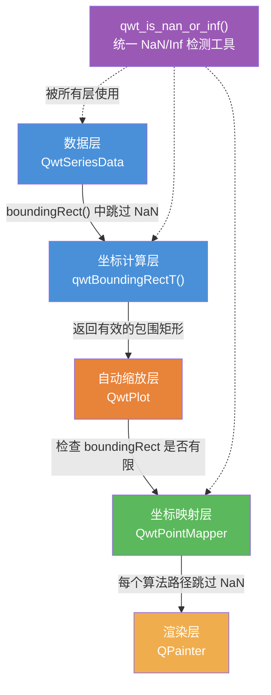
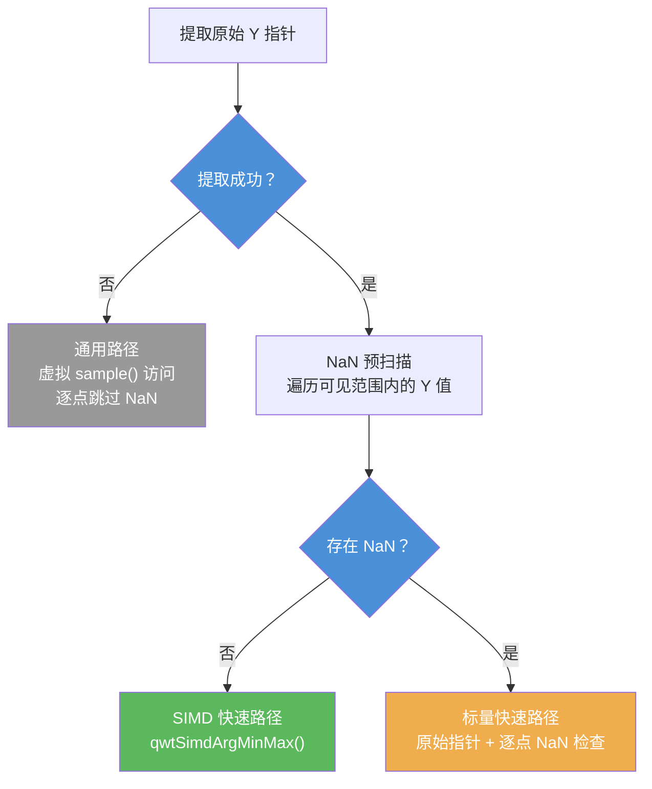
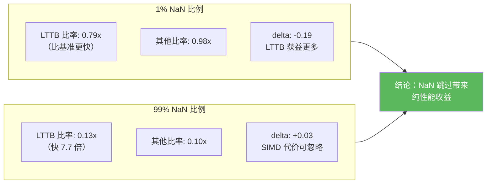

# NaN 数据处理

传感器故障、采样间隔不均、数据处理管道中的异常值等都可能产生 `NaN`（Not a Number）值。如果绘图库不能正确处理 NaN，轻则导致坐标轴范围错误、曲线渲染异常，重则引发程序崩溃。

Qwt 7 能正确处理 NaN 数据，并针对含 NaN 的数据做了性能优化，这是原版 Qwt 6 不具备的。在 Qwt 6 中，NaN 数据会导致 boundingRect 被污染（返回无效矩形）、坐标映射产生错误像素坐标、自动缩放失效等一系列 bug。Qwt 7 从底层工具函数到绘制管线，各层都加入了 NaN 处理。

> **说明 — Qwt 7 新增功能**
>
> NaN 数据的正确处理和性能优化是 Qwt 7 相对于原版 Qwt 6.2.0 的重要改进之一。所有核心改进均在 2025 年 12 月由项目维护者添加。

## NaN 处理架构概览

Qwt 7 的 NaN 处理贯穿整个 2D 绘图管线，从数据层到渲染层：



## 核心工具函数：qwt_is_nan_or_inf()

源文件：`src/core/qwt_math.h`

Qwt 7 新增了统一的 NaN/Inf 检测函数族，作为所有 NaN 处理的基础设施。原版 Qwt 6 没有这种统一的检测工具。

### 函数重载

通过 SFINAE 提供三个重载，覆盖不同数据类型：

```cpp
// 1. 浮点类型：使用 std::isfinite() 同时检测 NaN 和 Inf
template< typename T >
inline typename std::enable_if< std::is_floating_point< T >::value, bool >::type
qwt_is_nan_or_inf(const T& value)
{
    return !std::isfinite(value);
}

// 2. QPointF 类型：检测 x 和 y 两个坐标
inline bool qwt_is_nan_or_inf(const QPointF& point)
{
    return !std::isfinite(point.x()) || !std::isfinite(point.y());
}

// 3. 非浮点类型：永远返回 false
template< typename T >
typename std::enable_if< !std::is_floating_point< T >::value
    && !std::is_same< T, QPointF >::value, bool >::type
inline qwt_is_nan_or_inf(const T& /*value*/)
{
    return false;
}
```

### 辅助模板函数

除了基础检测函数外，还提供了以下工具：

| 函数 | 功能 |
|------|------|
| `qwtContainsNanOrInf(first, last)` | 检测迭代器范围内是否包含 NaN/Inf |
| `qwtRemoveNanOrInf(container)` | 原地删除容器中所有 NaN/Inf 值 |
| `qwtRemoveNanOrInfCopy(container)` | 返回去除 NaN/Inf 的新容器 |

## boundingRect 中的 NaN 处理

源文件：`src/core/qwt_series_data.cpp`

### Qwt 6 的问题

原版 Qwt 6.2.0 的 `qwtBoundingRectT()` 模板在计算数据系列的包围矩形时，不跳过 NaN 样本。由于 IEEE 754 浮点比较语义（`NaN < x` 和 `NaN > x` 均为 `false`），NaN 值会导致：

- 包围矩形的边界被污染为无效值
- 自动缩放收到错误的范围，坐标轴显示异常
- 后续坐标映射产生错误结果

### Qwt 7 的改进

Qwt 7 在 `qwtBoundingRectT<T>()` 的两个循环中均添加了 NaN 跳过逻辑：

```cpp
template< class T >
QRectF qwtBoundingRectT(const QwtSeriesData< T >& series, size_t from, size_t to)
{
    QRectF boundingRect(1.0, 1.0, -2.0, -2.0);  // invalid

    // ... 前置检查 ...

    // 第一个循环：找到首个有效样本作为初始 boundingRect
    size_t i;
    for (i = from; i <= to; i++) {
        // chenzongyan modify at 202512: add nan checking
        if (isSampleNanOrInf(series.sample(i))) {
            continue;  // 跳过 NaN/Inf 样本
        }
        const QRectF rect = qwtBoundingRect(series.sample(i));
        if (rect.width() >= 0.0 && rect.height() >= 0.0) {
            boundingRect = rect;
            i++;
            break;
        }
    }

    // 第二个循环：扩展 boundingRect
    for (; i <= to; i++) {
        // chenzongyan modify at 202512: add nan checking
        if (isSampleNanOrInf(series.sample(i))) {
            continue;  // 跳过 NaN/Inf 样本
        }
        const QRectF rect = qwtBoundingRect(series.sample(i));
        // ... 扩展 boundingRect ...
    }

    return boundingRect;
}
```

### isSampleNanOrInf() 类型重载

`isSampleNanOrInf()` 为每种样本类型提供了独立重载，确保所有数据类型都能正确检测 NaN：

| 样本类型 | 检测的字段 |
|---------|-----------|
| `QPointF` | x, y（委托 `qwt_is_nan_or_inf()`） |
| `QwtPoint3D` | x, y, z |
| `QwtPointPolar` | azimuth, radius |
| `QwtIntervalSample` | value, interval.minValue, interval.maxValue |
| `QwtOHLCSample` | close, high, low, open, time |
| `QwtBoxSample` | position, whiskerLower, q1, median, q3, whiskerUpper |
| `QwtVectorFieldSample` | x, y, vx, vy |
| `QwtSetSample` | 在 `qwtBoundingRect(QwtSetSample)` 内部单独处理 |

## 坐标映射中的 NaN 处理

源文件：`src/plot/qwt_point_mapper.cpp`

`QwtPointMapper` 是坐标映射的核心类，所有降采样和坐标变换路径都在此实现。Qwt 7 确保每一条映射路径都跳过 NaN 点。

### 各降采样算法的 NaN 处理

| 算法 | 函数 | NaN 处理方式 |
|------|------|-------------|
| 连续重复点过滤 | `qwtToPolylineFiltered()` | 先找首个非 NaN 点，循环中 `continue` 跳过 NaN |
| Quad Reduce | `qwtMapPointsQuad()` | 先找首个非 NaN 点，循环中 `continue` 跳过 NaN |
| Pixel-Column Reduce | `qwtPixelColumnReduce()` | 循环中 `continue` 跳过 NaN |
| MinMax Bucket Reduce | `qwtMinMaxBucketReduce()` | NaN 预扫描 → 选择 SIMD/标量路径 |
| 散点映射 | `qwtToPoints()` / `qwtToPointsFiltered()` | 循环中 `continue` 跳过 NaN |
| 图像渲染 | `qwtRenderDots()` | 循环中 `continue` 跳过 NaN |

### 典型处理模式

大部分算法采用同一种模式：先找到首个有效点作为起始，再在主循环中跳过 NaN。

```cpp
// 1. 找到第一个非 NaN 样本
int realFrom = from;
QPointF sample0 = series->sample(from);
while (realFrom < to && qwt_is_nan_or_inf(sample0)) {
    realFrom++;
    sample0 = series->sample(realFrom);
}
// 如果全部是 NaN，返回空多边形
if (realFrom >= to && qwt_is_nan_or_inf(sample0))
    return polyline;

// 2. 主循环中跳过 NaN
for (int i = realFrom; i <= to; i++) {
    const QPointF sample = series->sample(i);
    if (qwt_is_nan_or_inf(sample))
        continue;
    // ... 正常处理 ...
}
```

### MinMax Bucket Reduce 的 NaN 预扫描（LTTB 路径）

`qwtMinMaxBucketReduce()` 是 Qwt 7 新增的 LTTB 降采样算法，其 NaN 处理最为复杂：用预扫描决定是否使用 SIMD 加速路径。



需要预扫描，是因为存在 NaN 时 SIMD 路径的 argmin/argmax 结果可能受到干扰。预扫描只需 O(n) 一次遍历，一旦发现 NaN 就切换到标量路径，标量路径可以逐点跳过 NaN。当数据完全无 NaN 时（常见场景），SIMD 路径提供 3-4 倍加速。

## SIMD 模块中的 NaN 语义

源文件：`src/core/qwt_simd_argminmax.h`、`src/core/qwt_simd_argminmax.cpp`

`qwtSimdArgMinMax()` 使用 IEEE 754 比较语义自然忽略 NaN 值：

### IEEE 754 有序比较

SIMD 实现使用有序比较谓词 `_CMP_LT_OQ` 和 `_CMP_GT_OQ`，当任一操作数为 NaN 时返回 `false`。因此 NaN 值永远不会成为新的 min/max，被"自然忽略"：

```cpp
// SSE4.2 示例
const __m128d cmpMin = _mm_cmp_pd(vals, minVec, _CMP_LT_OQ);
minIdxVec = _mm_blendv_pd(minIdxVec, curIdx, cmpMin);
minVec = _mm_min_pd(minVec, vals);
```

### 全 NaN 输入的兜底处理

当所有元素都是 NaN 时，初始化的 `DBL_MAX`/`-DBL_MAX` 不会被更新。公共 API 层添加了后检查：

```cpp
QwtArgMinMaxResult qwtSimdArgMinMax(const double* data, int count)
{
    // ... 调用 SIMD/标量实现 ...
    QwtArgMinMaxResult result = kFn(data, count);

    // 全 NaN 输入的兜底
    if (std::isnan(result.minVal) || std::isnan(result.maxVal))
        return { 0, 0, DBL_MAX, -DBL_MAX };

    return result;
}
```

## 曲线绘制中的 NaN 处理覆盖

源文件：`src/plot/qwt_plot_curve.cpp`

不同绘制风格对 NaN 的处理现已全部覆盖：

| 绘制风格 | NaN 处理 | 实现方式 |
|---------|---------|---------|
| Lines（含所有降采样模式） | 已处理 | 委托 QwtPointMapper |
| Dots（默认路径） | 已处理 | 委托 QwtPointMapper |
| Symbols | 已处理 | 委托 QwtPointMapper |
| Dots（MinimizeMemory 路径） | 已处理 | 直接迭代，`isSampleNanOrInf()` 跳过 |
| Sticks | 已处理 | 直接迭代，`isSampleNanOrInf()` 跳过 |
| Steps | 已处理 | 直接迭代，`isSampleNanOrInf()` 跳过 |

> **警告 — 跳过不等于断开**
>
> 早期版本中 `Sticks`、`Steps` 与 `Dots` 的 `MinimizeMemory` 路径不检查 NaN；自提交 `17d0d13` 起这些路径（以及 `closestPoint()`）已补上 `isSampleNanOrInf()` 跳过检查，所有风格均安全。但要注意跳过语义的含义：Lines 类与 Steps 对 NaN 是"跳过并桥接"：缺口会被一条数据中不存在的线段（桥接弦）跨过，折线不会在缺口处断开留白；只有 `Dots`/`Sticks` 这类逐样本风格能让缺口天然空白。若需要"缺口即空白"的断线语义，可开启 `QwtPlotCurve::BreakAtNan` 曲线属性（见下文最佳实践），或在数据端按 NaN 把序列切成多个有限段、每段一条曲线。定量语义矩阵与像素级视觉扫描见[技术报告](../../tech-report/nan-rendering.md)。

## 自动缩放中的 NaN 防护

源文件：`src/plot/qwt_plot.cpp`、`src/plot/qwt_plot_axis.cpp`

自动缩放有两条独立路径，各自的 NaN 防护形式不同。`QwtPlot::rescaleAxes()` 在合并范围前检查 item boundingRect 的有效性与四边有限性（谓词为 `qwt_is_nan_or_inf()`，同时拦截 Inf）：

```cpp
// qwt_plot.cpp — rescaleAxes()：检查 boundingRect 是否有效（含 NaN 和无穷大检查）
if (boundingRect.isValid() && !boundingRect.isEmpty() && !qwt_is_nan_or_inf(boundingRect.left())
    && !qwt_is_nan_or_inf(boundingRect.right()) && !qwt_is_nan_or_inf(boundingRect.top())
    && !qwt_is_nan_or_inf(boundingRect.bottom())) {
    // ... 合并进自动缩放范围 ...
}
```

replot 时走的 `QwtPlot::updateAxes()` 则只按 `width() >= 0` / `height() >= 0` 判断：全 NaN 序列的 boundingRect 是无效矩形 `QRectF(1, 1, -2, -2)`（宽、高均为 -2），会被整体跳过，对应轴的区间保持无效，最终落到 `AxisData` 的默认范围 0–1000。这就是全 NaN 曲线坐标轴回落到 0–1000、画布空白的来源：

```cpp
// qwt_plot_axis.cpp — updateAxes()：无效矩形被直接跳过，不会污染轴区间
const QRectF rect = item->boundingRect();
if (rect.width() >= 0.0)
    boundingIntervals[item->xAxis()] |= QwtInterval(rect.left(), rect.right());
if (rect.height() >= 0.0)
    boundingIntervals[item->yAxis()] |= QwtInterval(rect.top(), rect.bottom());
```

两条路径的双重防护确保了即使 boundingRect 被意外污染（例如未来回归 bug），自动缩放也不会收到无效的范围值。

## 其他模块的 NaN 处理

### 等高线算法

`QwtRasterData` 的 CONREC 等高线算法通过累加和检测 NaN：NaN 参与加法运算会使结果变为 NaN（当前源码使用 `qwt_is_nan_or_inf()`，同时拦截 Inf）：

```cpp
if (qwt_is_nan_or_inf(zSum)) {
    // 其中一个点是 NaN 或 Inf
    continue;
}
```

### Spectrogram 渲染

Spectrogram（光谱图/热力图）将 NaN 值视为数据缺口（gap），渲染为透明像素。早期版本因 `qIsNaN()` 未内联且 `qt_is_nan` 位于 Qt 私有头文件而实现过本地的位级 NaN 检测（`qwtIsNaN`），当前源码已将其移除，统一使用 core 模块的 `qwt_is_nan_or_inf()`。渲染时，NaN 值被渲染为透明像素（`0u`）：

```cpp
if (hasGaps && qwt_is_nan_or_inf(value)) {
    *line++ = 0u;  // 透明像素
}
```

### WithoutGaps 性能标志

`QwtRasterData::WithoutGaps` 属性标志告知渲染器数据无缺口，可跳过 NaN 检查以提升性能：

```cpp
// 如果数据没有缺口，启用 WithoutGaps 可跳过 NaN 检查
rasterData->setAttribute(QwtRasterData::WithoutGaps, true);
```

## nanperf 性能基准测试

> **说明 — Qwt 7 新增示例**
>
> `examples/2D/nanperf/` 是 Qwt 7 新增的性能基准测试示例，用于对比不同 NaN 分布和降采样模式下的渲染性能。原版 Qwt 6 没有此示例。

### 示例概述

nanperf 示例提供了一个 GUI 工具，可交互式地测试 NaN 数据对渲染性能的影响：

- 6 种 NaN 分布场景：前导 NaN、首尾 NaN、中间 NaN、尾部 NaN、X+Y 同时 NaN、X/Y 交替 NaN
- 5 种降采样模式：ClipPolygons、FilterPoints、FilterPointsAggressive、FilterPointsPixel、FilterPointsLTTB
- 可配置参数：数据点数（1,000 ~ 10,000,000）、NaN 比例（0% ~ 99%）、重复次数
- 瓶颈分析：计算 SIMD 悬崖效应和数据缩减效应的差异

### 界面布局

示例主窗口包含：

1. **控制栏**：模式选择、数据点数、NaN 比例、重复次数、操作按钮
2. **6 个绘图面板**：以 2×3 网格排列，每个面板对应一种 NaN 分布场景
3. **指标表格**：显示每个（场景 × 模式）组合的 boundingRect 时间、replot 时间、FPS、NaN 点数
4. **瓶颈分析**：自动生成的分析文本，隔离 SIMD 悬崖效应和数据缩减效应

### NaN 分布场景

| 场景 | 说明 | 测试目的 |
|------|------|---------|
| No NaN Baseline | 无 NaN 基准 | 作为性能对比的参照 |
| Leading NaN | 数据开头为 NaN，后续为信号 | 测试前导 NaN 对首个有效点查找的影响 |
| Leading & Trailing NaN | 数据首尾为 NaN，中间为信号 | 测试两端 NaN 的影响 |
| Middle NaN | 数据中间为 NaN，两端为信号 | 测试中间断隙对曲线连续性的影响 |
| X+Y Middle NaN | X 和 Y 同时为 NaN（中间位置） | 测试非单调 X 的影响（破坏二分搜索优化） |
| X/Y Interleaved NaN | X-only 和 Y-only NaN 交替（中间位置） | 测试部分坐标 NaN 的影响 |

### 瓶颈分析逻辑

nanperf 的 `BenchmarkRunner::analyze()` 方法将性能差异分解为两个因素：

1. SIMD 悬崖效应（仅影响 LTTB）：当数据中存在任何 NaN 时，`qwtMinMaxBucketReduce` 的预扫描会全局禁用 SIMD，回退到标量路径。通过对比 LTTB 在有/无 NaN 时的性能比率来衡量。
2. 数据缩减效应（影响所有模式）：NaN 点被跳过后，需要处理的有限点更少，渲染更快。通过对比非 LTTB 模式在有/无 NaN 时的性能比率来衡量。

两者的差值（delta）隔离了 SIMD 悬崖效应：

- delta < 0：LTTB 从数据缩减中获益更多（SIMD 代价在低 NaN 比例下可忽略）
- 0 ≤ delta ≤ 0.1：SIMD 代价边际效应（在高 NaN 比例下标量开销可忽略）
- delta > 0.1：SIMD 悬崖显著可见（LTTB 被标量回退拖慢）

### 基准测试结果

以下为两组典型测试结果，测试环境：100,000 数据点，20 次重复取平均。其中 `FilterPointsLTTB` 的数据由 v7.4.2 实现（MinMax 桶）测得；自 v7.5.0 起该属性映射到真 LTTB。

#### 低 NaN 比例（1%）

| 场景 | 模式 | boundingRect (ms) | replot (ms) | FPS | NaN 点数 |
|------|------|-------------------|-------------|-----|---------|
| No NaN Baseline | ClipPolygons | 8.615 | 116.850 | 8.6 | 0 |
| No NaN Baseline | FilterPointsLTTB | 8.777 | 12.440 | 80.4 | 0 |
| Leading NaN | FilterPointsLTTB | 8.089 | 9.726 | 102.8 | 1000 |
| Middle NaN | FilterPointsLTTB | 8.351 | 10.444 | 95.7 | 1000 |
| X+Y Middle NaN | FilterPointsLTTB | 8.257 | 9.601 | 104.2 | 1000 |

瓶颈分析：

- boundingRect：基准 8.634 ms vs NaN 8.396 ms，冷缓存 O(n) 扫描（实际使用中会缓存，仅在数据变化时重新计算）
- FilterPointsLTTB：NaN 9.849 ms vs 基准 12.440 ms（0.79x），LTTB 从数据缩减中获益更多，SIMD 代价在 1% NaN 比例下可忽略
- 其他模式：NaN 54.634 ms vs 基准 55.644 ms（0.98x），无 SIMD 路径，比率反映纯数据缩减效果
- delta = -0.19 → LTTB 从数据缩减中获益更多

#### 高 NaN 比例（99%）

| 场景 | 模式 | boundingRect (ms) | replot (ms) | FPS | NaN 点数 |
|------|------|-------------------|-------------|-----|---------|
| No NaN Baseline | ClipPolygons | 8.730 | 115.466 | 8.7 | 0 |
| No NaN Baseline | FilterPointsLTTB | 8.362 | 13.244 | 75.5 | 0 |
| Leading NaN | FilterPointsLTTB | 3.388 | 1.614 | 619.6 | 99000 |
| Middle NaN | FilterPointsLTTB | 3.468 | 1.762 | 567.6 | 99000 |
| X+Y Middle NaN | FilterPointsLTTB | 2.720 | 1.896 | 527.4 | 99000 |

瓶颈分析：

- boundingRect：基准 8.540 ms vs NaN 3.164 ms，NaN 点被跳过后扫描更快
- FilterPointsLTTB：NaN 1.700 ms vs 基准 13.244 ms（0.13x），99% 数据被跳过，渲染速度大幅提高
- 其他模式：NaN 5.524 ms vs 基准 54.860 ms（0.10x），纯数据缩减效果
- delta = +0.03 → SIMD 代价边际效应，在高 NaN 比例下标量开销可忽略

### 结果总结

下面的流程图汇总了两轮基准测试：1% NaN 比例下 LTTB 路径仍优于无 NaN 基准（replot 耗时 0.79x），99% 比例下所有模式都大幅加速（0.10–0.13x），SIMD 回退代价在两种情况下都可以忽略：



关键发现：

1. NaN 跳过不会导致性能下降：在所有测试场景中，有 NaN 的数据渲染速度均快于或等于无 NaN 基准，因为跳过 NaN 减少了需要处理的有限点数。
2. SIMD 悬崖效应可忽略：即使在 1% NaN 比例下，LTTB 因预扫描禁用 SIMD 而回退标量路径，其性能仍然优于无 NaN 基准（0.79x），因为数据缩减的收益远大于 SIMD 损失。
3. 高 NaN 比例下性能大幅提升：99% NaN 时，LTTB 的 replot 时间从 13.2ms 降至 1.7ms（7.7 倍加速），FPS 从 75.5 提升至 619.6。
4. NaN 分布位置不影响性能：前导、中间、尾部、交替等不同 NaN 分布方式对性能的影响几乎一致，说明 Qwt 7 的 NaN 处理不受样本位置影响。

### 运行 nanperf 示例

> **说明 — 构建与运行**
>
> nanperf 示例默认包含在构建中。使用 `build.ps1` 构建后，可在 `build/bin/` 目录下找到 `nanperf.exe`。
>
> ```powershell
> # 构建（包含示例）
> .\build.ps1 build
>
> # 运行
> .\build\bin\nanperf.exe
> ```
>
> 也可在 CMake 构建时通过 `-DQWT_CONFIG_BUILD_EXAMPLE=ON`（默认）确保示例被构建。

### 界面操作指南

1. **调整参数**：在顶部控制栏设置数据点数、NaN 比例、重复次数
2. **Apply & Redraw**：立即将当前参数应用到所有 6 个面板并重绘
3. **Run Benchmark Sweep**：运行完整的 5 模式 × 7 场景（含基准）基准测试
4. **Export Markdown**：将测试结果导出为 Markdown 表格文件

## 最佳实践

### 数据准备

缺失的样本用 quiet NaN 标记（直接用 Qt 的 `qQNaN()` 工具函数生成），像普通数值一样追加进数据向量即可；`boundingRect()` 与渲染器都会自动跳过它们，坐标轴范围无需额外处理就能保持正确。注意"跳过"指折线在缺口处被桥接连通而非断开留白；需要缺口显示为空白时，参见上文"曲线绘制中的 NaN 处理覆盖"的警告与[技术报告](../../tech-report/nan-rendering.md)：

```cpp
// 使用 qQNaN() 生成 NaN 值
const double nan = qQNaN();
QVector< double > x, y;
for (int i = 0; i < n; ++i) {
    x.append(i);
    if (should_be_missing(i))
        y.append(nan);       // NaN 表示数据缺失
    else
        y.append(signal(i));  // 正常数据
}
curve->setSamples(x, y);
// boundingRect 会自动跳过 NaN，坐标轴范围正确
```

### 选择绘制风格

所有绘制风格现在都会跳过 NaN 样本（见上文覆盖表），处理含 NaN 的数据时可优先选 `QwtPlotCurve::Lines` 风格：它具备完整的 NaN 处理，且默认启用的 `FilterPointsLTTB` 渲染属性同时提供最佳性能。注意 Lines/Steps 的跳过语义是"桥接"：缺口会被一条线段跨过而非断开留白；需要缺口显示为空白时可开启 `BreakAtNan` 曲线属性（见下一节），或在数据端按有限段切分成多条曲线，或改用逐样本绘制的 `Dots`/`Sticks` 风格：

```cpp
// 推荐：Lines 风格 — 完整的 NaN 处理（跳过语义，缺口以弦桥接）
curve->setStyle(QwtPlotCurve::Lines);
// 默认启用 FilterPointsLTTB，提供最佳性能和 NaN 兼容性

// 缺口必须显示为空白时：开启 BreakAtNan（见下节），
// 或在数据端按有限段切分为多条曲线（每段一条），
// 或改用 Dots / Sticks 逐样本风格
```

### 缺口语义：BreakAtNan 属性

默认情况下曲线渲染为一条连续折线：NaN/Inf 样本被跳过，缺口两侧的有限样本被一条数据中不存在的桥接弦连起来。`QwtPlotCurve::BreakAtNan` 曲线属性把 Lines 与 Steps 切换为切段语义：每个由连续有限样本构成的段渲染为一条独立折线，缺口保持空白，与 matplotlib 的行为一致：

```cpp
QwtPlotCurve* curve = new QwtPlotCurve();
curve->setSamples(x, y);   // y 含 qQNaN() 缺口
curve->setCurveAttribute(QwtPlotCurve::BreakAtNan, true);
curve->attach(plot);
```

行为细节：

- 逐段处理：每个段独立做平滑、拟合（`Fitted`）、裁剪与填充，平滑核与填充区域都不会跨越缺口，每段的填充独立闭合到基线。
- 逐段降采样：渲染属性（`FilterPointsLTTB` 等）的降采样预算按段分配；短段会回退到更简单的过滤算法，这是逐段渲染的定义性代价。
- 对 Dots/Sticks 无效果：这两种风格逐样本绘制、本来就跳过 NaN/Inf 样本，缺口天然空白。
- 段扫描缓存：有限段的扫描在每次数据变更时只做一次（与序列 boundingRect 同一缓存生命周期），之后每次重绘直接复用，交互式缩放/平移不会重复支付 O(n) 扫描。就地修改内容的自定义 `QwtSeriesData` 实现需要触发 `dataChanged()`（例如重新调用 `setData()`）才能刷新缓存。
- 默认关闭：不开启该属性时行为与之前完全一致：缺口仍被桥接。

### Spectrogram 中的数据缺口

在频谱图中，NaN 单元默认被渲染成透明缺口，对 `QwtPlotSpectrogram` 来说这通常正是想要的效果。只有当栅格数据确实没有缺口时，才应通过 `setAttribute()` 设置 `QwtRasterData::WithoutGaps` 属性，跳过逐单元的 NaN 检查：

```cpp
// 如果数据确实包含缺口（NaN），保持默认设置即可
// Spectrogram 会自动将 NaN 渲染为透明区域

// 如果数据没有缺口，启用 WithoutGaps 标志以跳过 NaN 检查
rasterData->setAttribute(QwtRasterData::WithoutGaps, true);
```

## API 参考

- [曲线降采样算法](../../tech-report/curve-downsampling.md) — 四种降采样算法的详细说明
- [曲线图](../2d/curve.md) — QwtPlotCurve 的渲染属性配置
