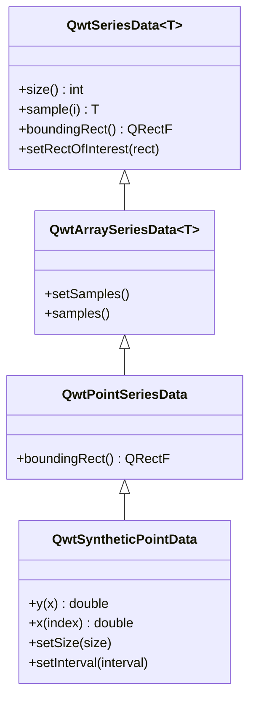

# 数据系列 - QwtSeriesData

`QwtSeriesData` 是绘图项数据的抽象接口。自定义 `QwtSeriesData` 派生类可以从内存、文件、数据库等任意数据源提供绘图数据。

## 主要功能特性

- 数据抽象接口：定义统一的数据访问接口
- 多种内置实现：内存存储、外部数组引用等常用实现
- 动态数据支持：支持实时更新和大数据场景
- 边界计算：自动计算数据边界矩形

## 基本概念

### 数据接口结构

下面的类图勾勒了 `QwtSeriesData<T>` 接口（`size()`、`sample(i)`、`boundingRect()` 与可选的 `setRectOfInterest()`）以及内置的派生实现：以 `QVector` 存放样本并提供 `setSamples()` / `samples()` 的泛型 `QwtArraySeriesData<T>`、其 `QPointF` 特化 `QwtPointSeriesData`，以及从 `QwtPointSeriesData` 派生、通过纯虚函数 `y(double x)` 即时计算样本而不存储数据的 `QwtSyntheticPointData`：



### 内置数据类

| 类名 | 说明 |
|------|------|
| `QwtArraySeriesData<T>` | 以 `QVector` 存储任意类型样本数组，提供 `setSamples()` / `samples()` |
| `QwtPointSeriesData` | 存储 `QPointF` 数据点（即 `QwtArraySeriesData<QPointF>`） |
| `QwtSyntheticPointData` | 通过纯虚函数 `y(double x)` 即时生成函数数据（不存储） |

`QwtArraySeriesData<T>` 还有其他样本类型的特化，如 `QwtPoint3DSeriesData`、`QwtIntervalSeriesData`、`QwtSetSeriesData`、`QwtTradingChartData`、`QwtBoxChartData` 等。

## 使用方法

### 1. 使用内置数据类

多数需求用不着自定义类：`QwtPlotCurve` 的 `setSamples()` 各种重载已经覆盖常见情况；如果想显式管理数据对象，也可以像下面两种写法那样，用 `QwtPointSeriesData` 包装数据点再通过 `setData()` 交给曲线：

```cpp
#include <QwtPlotCurve>
#include <QwtPointSeriesData>

QwtPlotCurve* curve = new QwtPlotCurve();

// 方法1：直接使用QwtPlotCurve的便捷方法
QVector<double> xData, yData;
curve->setSamples(xData, yData);

// 方法2：使用QwtPointSeriesData
QwtPointSeriesData* seriesData = new QwtPointSeriesData();
QVector<QPointF> points;
points << QPointF(0, 0) << QPointF(1, 1) << QPointF(2, 4);
seriesData->setSamples(points);
curve->setData(seriesData);
```

### 2. 引用外部数据

当数据已经存放在你自己的缓冲区里时，`setRawSamples()` 让曲线直接引用原始 `double` 数组而不做复制，这是大数据量下最快的路径，代价是数组的存活期要由你自己保证：

```cpp
#include <QwtPlotCurve>

QwtPlotCurve* curve = new QwtPlotCurve();

// 使用setRawSamples引用外部数组（不复制）
double x[1000], y[1000];
curve->setRawSamples(x, y, 1000);

// 注意：数组必须在curve存在期间保持有效
// 数据变化时无需重新设置，直接replot即可
```

> **警告 — setRawSamples注意事项**
>
> - 外部数组必须保持有效直到曲线销毁
> - 不要修改数组大小，只修改内容
> - 数据更新后需调用replot刷新显示

### 3. 自定义数据类

实现自定义数据源：

```cpp
#include <QwtPointSeriesData>  // 提供 QwtSeriesData<T> 模板与内置点数据类

// 自定义数据库数据源
class DatabaseSeriesData : public QwtSeriesData<QPointF>
{
public:
    DatabaseSeriesData(const QString& tableName) 
        : m_tableName(tableName)
    {
        // 初始化数据库连接
        m_count = queryCount();
    }

    // 返回数据点数量
    virtual size_t size() const override
    {
        return m_count;
    }

    // 返回指定索引的数据点
    virtual QPointF sample(size_t i) const override
    {
        // 从数据库查询第i条记录
        return queryPoint(i);
    }

    // 计算数据边界
    virtual QRectF boundingRect() const override
    {
        if (m_boundingRect.isNull()) {
            // 计算边界矩形
            m_boundingRect = calculateBounds();
        }
        return m_boundingRect;
    }

private:
    QString m_tableName;
    size_t m_count;
    QRectF m_boundingRect;
    
    size_t queryCount() const;
    QPointF queryPoint(size_t i) const;
    QRectF calculateBounds() const;
};

// 使用自定义数据类
curve->setData(new DatabaseSeriesData("measurements"));
```

### 4. 函数生成数据

`QwtSyntheticPointData` 可以在不存储任何样本的情况下生成函数曲线：继承它并实现纯虚函数 `y(double x)`，再向基类构造函数传入等距采样点数与 x 轴区间即可；若区间保持无效值，则改为按当前可见绘图区域计算采样点：

```cpp
#include <cmath>
#include <QwtInterval>
#include <QwtSyntheticPointData>

// 函数数据生成器
class FunctionSeriesData : public QwtSyntheticPointData
{
public:
    FunctionSeriesData(double (*func)(double), double xMin, double xMax)
        : QwtSyntheticPointData(200, QwtInterval(xMin, xMax))  // 200个等距采样点
        , m_function(func)
    {
    }

    // 返回指定x位置的y值（唯一需要实现的纯虚函数）
    virtual double y(double x) const override
    {
        return m_function(x);
    }

private:
    double (*m_function)(double);
};

// 使用函数生成数据
double myFunction(double x) {
    return std::sin(x) * std::cos(2 * x);
}

curve->setData(new FunctionSeriesData(myFunction, 0.0, 10.0));
```

### 5. 实时数据更新

对流式数据场景，一个轻量的自定义 `QwtSeriesData<QPointF>` 子类往往是最干净的方案：下面的 `RealtimeSeriesData` 维护一个最多 1000 个点的滚动窗口，每次追加点后作废继承来的 `cachedBoundingRect` 缓存，使 `boundingRect()` 借助 `qwtBoundingRect()` 辅助函数重新计算，并在 `appendPoint()` 之后用一次 `plot->replot()` 刷新显示：

```cpp
// 实时数据场景
class RealtimeSeriesData : public QwtSeriesData<QPointF>
{
public:
    RealtimeSeriesData(int maxPoints = 1000)
        : m_maxPoints(maxPoints)
    {
    }

    void appendPoint(const QPointF& point)
    {
        m_points.append(point);
        if (m_points.size() > m_maxPoints) {
            m_points.removeFirst();
        }
        // 作废缓存的边界矩形，触发重新计算
        cachedBoundingRect = QRectF(0.0, 0.0, -1.0, -1.0);
    }

    virtual size_t size() const override { return m_points.size(); }
    virtual QPointF sample(size_t i) const override { return m_points[static_cast<int>(i)]; }
    virtual QRectF boundingRect() const override
    {
        if (!cachedBoundingRect.isValid()) {
            cachedBoundingRect = qwtBoundingRect(*this);
        }
        return cachedBoundingRect;
    }

private:
    QVector<QPointF> m_points;
    int m_maxPoints;
};

// 使用
RealtimeSeriesData* data = new RealtimeSeriesData(1000);
curve->setData(data);

// 实时添加数据
data->appendPoint(QPointF(time, value));
plot->replot();
```

## 核心方法总结

### QwtSeriesData接口

| 方法 | 说明 |
|------|------|
| `size()` | 返回数据点数量 |
| `sample(i)` | 返回第i个数据点 |
| `boundingRect()` | 返回数据边界矩形 |
| `setRectOfInterest()` | 设置感兴趣区域（优化渲染） |

### QwtPlotCurve数据方法

| 方法 | 说明 |
|------|------|
| `setData()` | 设置数据对象 |
| `setSamples()` | 设置数据数组 |
| `setRawSamples()` | 引用外部数组 |
| `data()` | 获取数据对象 |

> **提示 — 数据管理建议**
>
> - 静态数据：使用 `setSamples()` 复制数据
> - 大数据：使用 `setRawSamples()` 避免复制
> - 动态数据：实现自定义 `QwtSeriesData`
> - 函数数据：使用 `QwtSyntheticPointData`

> **示例 — 相关示例**
>
> - 函数生成数据：`examples/2D/sinusplot`
> - 实时数据：`examples/2D/realtime`
> - CPU监控：`examples/2D/cpuplot`

实时数据与CPU监控的例子截图如下：


